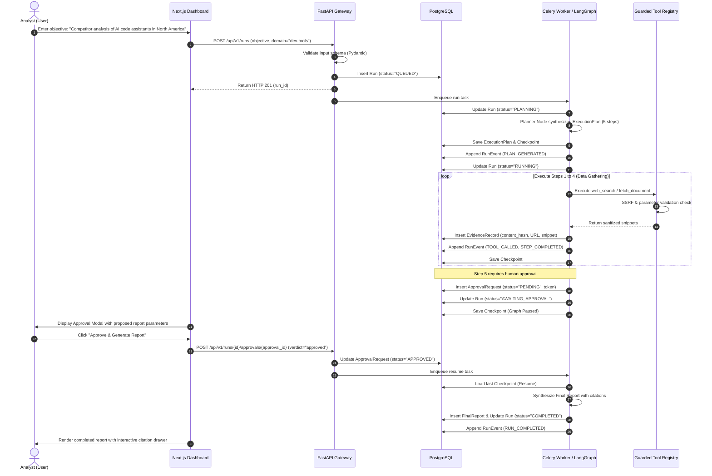

# Use Cases: AgentOps

This document specifies the operational use cases for AgentOps, detailing primary user journeys, edge cases, failure recovery, security interventions, and human-in-the-loop interactions.

---

## UC-01: Primary Demonstration — End-to-End Competitor Intelligence Research

- **Use Case ID**: `UC-01`
- **Primary Actor**: Research Analyst / Technical Evaluator
- **Description**: An analyst requests a competitor analysis of emerging AI code assistants in North America. The system validates the request, generates a bounded 5-step plan, retrieves public data using allowlisted tools, pauses for human approval before final synthesis, collects grounded evidence, and produces a structured report with clickable citations.
- **Preconditions**:
  - AgentOps services (API, PostgreSQL, Redis, Celery) are running.
  - `LLM_PROVIDER=mock` and `SEARCH_PROVIDER=mock` (or optional live keys provided).
- **Trigger**: Analyst submits request via web UI or API.

### Main Success Scenario

### Postconditions
- Final markdown report stored with empirical data separated from inferences.
- All factual claims link to verified `EvidenceRecord` entries.
- Run state in PostgreSQL marked `COMPLETED`.

---

## UC-02: Human-in-the-Loop Rejection & Safe Cancellation Flow

- **Use Case ID**: `UC-02`
- **Primary Actor**: Operator / Human Reviewer
- **Description**: The agent reaches a plan step flagged with `requires_human_approval = True`. The operator reviews the parameters, determines they exceed scope or contain undesirable criteria, and rejects the request.
- **Preconditions**: Run is in `AWAITING_APPROVAL` status with an active `ApprovalRequest`.
- **Trigger**: Operator clicks "Reject" in the UI or posts `verdict="rejected"` to the API.

### Main Flow
1. Operator inspects the pending action in the dashboard (e.g., proposed query targeting an unapproved competitor domain).
2. Operator enters reason: "Target competitor is outside geographical scope" and submits rejection.
3. API receives `POST /api/v1/runs/{id}/approvals/{approval_id}` with `verdict="rejected"`.
4. API updates `ApprovalRequest` record with status `REJECTED` and operator notes.
5. LangGraph coordinator aborts remaining plan steps and sets run status to `ABORTED_BY_OPERATOR`.
6. System logs `APPROVAL_REJECTED` and `RUN_ABORTED` events to the audit table.
7. UI updates run status badge to red `ABORTED_BY_OPERATOR` and displays the operator's rejection notes.

### Postconditions
- No external tool calls are executed after the rejection point.
- State graph terminates cleanly without unhandled exceptions.

---

## UC-03: SSRF Attack Interception & Security Enforcement

- **Use Case ID**: `UC-03`
- **Primary Actor**: External Malicious Actor / Adversarial Prompt Injection
- **Description**: An untrusted prompt or indirect injection attempts to force the agent to retrieve `http://169.254.169.254/latest/meta-data/` or `http://127.0.0.1:5432/`.
- **Preconditions**: Run is in `RUNNING` status; execution reaches `fetch_document` step.
- **Trigger**: Tool executor processes the URL parameter.

### Main Flow
1. The coordinator passes target URL `http://169.254.169.254/latest/meta-data/` to `fetch_document`.
2. `fetch_document` calls `app.core.security.validate_url_for_request(url)`.
3. The security validator parses the IP address and identifies it as a link-local cloud metadata address in `BLOCKED_IPV4_NETWORKS`.
4. Validator immediately raises `SecurityValidationError: Hostname resolved to blocked/private IP`.
5. Tool execution halts without opening any network socket.
6. The coordinator intercepts the security error, appends a `SECURITY_VIOLATION` event to the audit log, and marks the step as `FAILED_SECURITY_VIOLATION`.
7. The run aborts with status `FAILED_SECURITY_POLICY`.

### Postconditions
- Zero network packets transmitted to the blocked IP address.
- Full security violation context (target URL, rule violated, timestamp) preserved in audit log.

---

## UC-04: Tool Execution Failure with Automatic Retries & Graceful Degradation

- **Use Case ID**: `UC-04`
- **Primary Actor**: System / Network
- **Description**: An external search query encounters a transient HTTP 504 gateway timeout. The system automatically retries with exponential backoff and recovers, or gracefully continues if the step is non-fatal.
- **Preconditions**: Run is executing a multi-step research plan.
- **Trigger**: Upstream search API returns a transient 504 error.

### Main Flow
1. Tool executor invokes `web_search` for competitor pricing.
2. Search provider returns HTTP 504 Gateway Timeout.
3. Resilience engine catches transient error; retry count is 0 (< `MAX_RETRIES_PER_STEP` = 2).
4. System logs `STEP_RETRYING` event and sleeps for backoff period ($2^0 \times 1.0\text{s} = 1\text{s}$).
5. Tool executes attempt #2; successfully returns search results.
6. Step completes successfully; run proceeds to the next planned step.

### Alternative Flow: Exhausted Retries with Graceful Degradation
- If attempt #2 and attempt #3 also fail:
  1. Retry ceiling reached; step is marked `FAILED`.
  2. Coordinator checks if step is marked essential. Since it is non-critical data, the coordinator logs a warning event and continues to subsequent steps.
  3. Synthesizer completes the final report, adding an explicit disclaimer: *"Pricing data for Competitor C was unavailable due to upstream provider timeout."*
  4. Run status is set to `COMPLETED_WITH_WARNINGS`.

---

## UC-05: Operator Manual Cancellation

- **Use Case ID**: `UC-05`
- **Primary Actor**: Operator
- **Description**: An operator observes an in-progress run and decides to terminate it immediately.
- **Preconditions**: Run is in `RUNNING` or `AWAITING_APPROVAL` status.
- **Trigger**: Operator clicks "Cancel Run" on the dashboard.

### Main Flow
1. Operator clicks "Cancel Run" in the UI.
2. UI issues `POST /api/v1/runs/{id}/cancel`.
3. API dispatches a Celery task revocation request with `terminate=True`.
4. Run record in PostgreSQL is updated to status `CANCELLED`.
5. Worker stops executing in-flight steps.
6. UI confirms cancellation; partial logs up to the cancellation timestamp remain accessible for review.

---

## UC-06: Deterministic Offline Portfolio Evaluation

- **Use Case ID**: `UC-06`
- **Primary Actor**: Technical Evaluator / Reviewer
- **Description**: An evaluator clones the repository, runs `pytest backend/tests`, launches the stack via Docker Compose, and observes the complete competitor analysis workflow operating deterministically with 100% reproducible results and zero paid API keys.
- **Preconditions**: Fresh repository clone; Docker installed.
- **Trigger**: Evaluator executes quickstart commands from README.

### Main Flow
1. Evaluator clones repository and runs `pytest backend/tests`.
2. All baseline, security, and schema tests pass in < 1 second.
3. Evaluator copies `.env.example` to `.env` (defaults to `LLM_PROVIDER=mock`, `SEARCH_PROVIDER=mock`).
4. Evaluator runs `docker compose up -d`.
5. Evaluator opens `http://127.0.0.1:3000` and clicks "Run Demo Analysis".
6. System executes the competitor research workflow against the local fixture dataset, displays the plan DAG, prompts for mock approval, and generates the grounded report in < 5 seconds.
7. Evaluator inspects evidence citations and verifies zero outbound external network calls.
