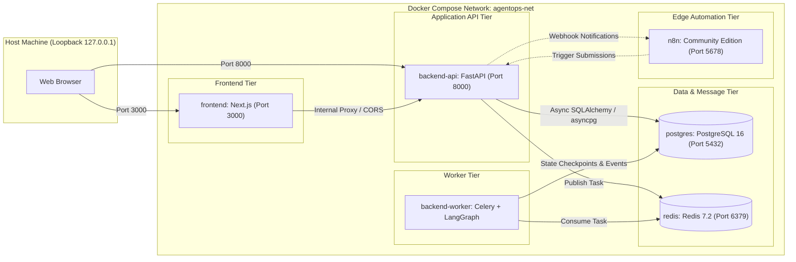
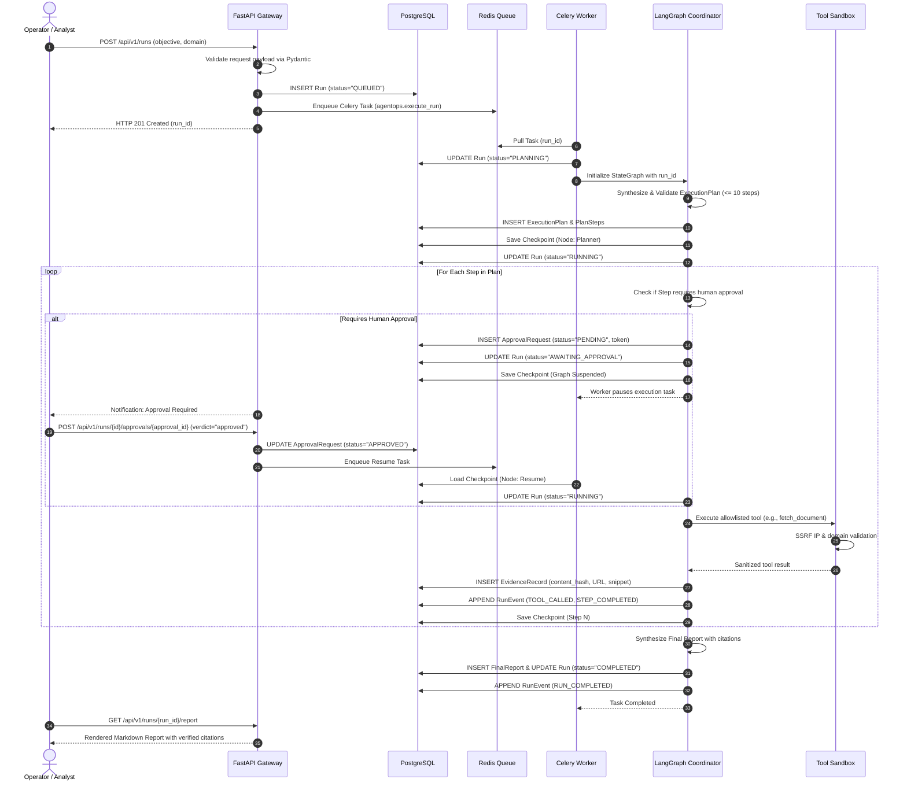
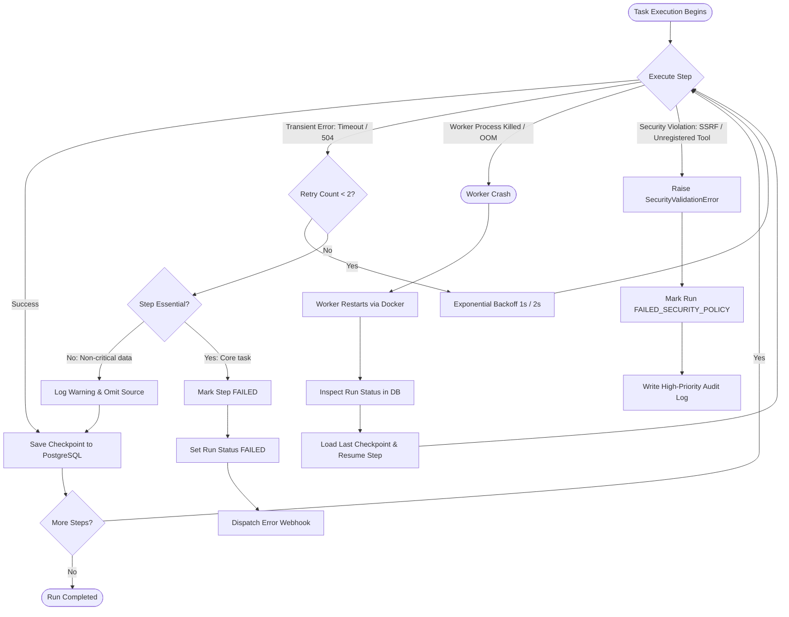

# System Architecture: AgentOps

## 1. System Overview & Context

**AgentOps** is a self-hosted AI Agent Operations Platform engineered to provide deterministic, observable, bounded, and auditable execution of research and analysis workflows. It is built around a **Single Coordinator Architecture** in Python, delegating async tasks to background workers and persisting durable state to PostgreSQL.

### 1.1 System Context Diagram

```mermaid
flowchart TD
    User["Human Operator / Analyst"] -->|HTTP / HTTPS| Frontend["Next.js Web Frontend"]
    User -->|Reviews & Approves Consequential Actions| Frontend

    Frontend -->|REST APIs & SSE Streams| API["FastAPI Gateway"]
    API -->|Persists Runs, Events, Evidence| DB[("PostgreSQL Database")]
    API -->|Enqueues Task Messages| Broker[("Redis Broker")]

    Broker -->|Pulls Work Orders| Worker["Celery Background Worker"]
    Worker -->|Executes State Graph| Engine["LangGraph Runtime"]

    Engine -->|State Checkpoints| DB
    Engine -->|Invokes Allowlisted Tools| ToolBox["Guarded Tool Sandbox"]
    Engine -->|Requests Plan & Synthesis| ModelAdapt["LLM Provider Adapter"]

    ToolBox -->|SSRF-Filtered HTTP| Web["Public Web / Target Domains"]
    ToolBox -->|Searches Corpus| SearchAdapt["Search Provider Adapter"]

    ModelAdapt -->|Default| MockLLM["Deterministic Mock LLM"]
    ModelAdapt -.->|Optional| LiveLLM["OpenAI / Ollama"]

    SearchAdapt -->|Default| MockSearch["Deterministic Mock Search Corpus"]
    SearchAdapt -.->|Optional| LiveSearch["Tavily Search API"]

    API -.->|Notification Webhooks (HMAC)| N8N["n8n Automation Engine"]
    N8N -.->|Trigger Run Webhook| API
```

---

## 2. Container & Service Architecture

AgentOps is containerized using Docker Compose for local-first deployment. The architecture consists of six dedicated services:



### 2.1 Service Responsibilities

| Container Service | Primary Responsibilities | Trust Boundary |
| :--- | :--- | :--- |
| **frontend** | Renders React/TypeScript UI, run inspector, evidence drawer, HITL approval prompt. | Untrusted client tier; executes in user browser. |
| **backend-api** | Input validation (Pydantic), authentication/authorization, run creation, approval tokens, REST API endpoints. | Trusted gateway; enforces boundary checks. |
| **backend-worker** | Executes Celery background tasks, coordinates LangGraph state machine, invokes allowlisted tools. | Trusted execution domain; enforces timeouts and budgets. |
| **postgres** | Stores relational domain entities (Runs, Plans, Steps, Events, Evidence, Reports, Approvals, LangGraph Checkpoints). | Single source of truth for all application state. |
| **redis** | In-memory message broker for Celery queues and task result caching. | Transient transport; holds no durable run state. |
| **n8n** | External notification dispatch (Slack, email) and incoming trigger workflows. | External automation edge; NOT a source of truth. |

---

## 3. Agent Execution Lifecycle

The lifecycle of a research run transitions through six deterministic states:



---

## 4. Component Interaction & State Ownership

### 4.1 PostgreSQL as the Single Source of Truth
To prevent architectural drift and distributed split-brain scenarios:
- **All authoritative run state** resides in PostgreSQL.
- **LangGraph Checkpoints** are serialized directly to PostgreSQL (`checkpoints` and `checkpoint_blobs` tables) using the PostgreSQL checkpointer.
- **n8n is strictly forbidden from holding primary run state**. n8n communicates solely via standard REST API endpoints with HMAC authentication; it never connects directly to the database or modifies run records.

### 4.2 Redis & Celery Messaging Architecture
- **Redis** operates as a transient task broker. If Redis is restarted or flushed, no historical run data or evidence is lost; active tasks are safely recovered or re-queued from PostgreSQL records.
- Celery worker tasks are idempotent; before executing a step, the worker verifies the current step index against PostgreSQL.

---

## 5. Traceability & Context Propagation

Every operation is tagged with four correlation identifiers to guarantee end-to-end auditability:

| Identifier | Generation Point | Scope | Propagation Mechanism |
| :--- | :--- | :--- | :--- |
| `correlation_id` | API Gateway (Middleware) | Entire HTTP request / response lifecycle | HTTP header `X-Correlation-ID`, structured log context. |
| `trace_id` | OpenTelemetry Tracer | Distributed trace spanning API, Celery, and DB | W3C `traceparent` header propagated in HTTP and Celery task headers. |
| `run_id` | API Gateway | Unique identifier for the research run | Stored in DB, passed as primary argument to Celery tasks and LangGraph state. |
| `step_id` | LangGraph Planner Node | Identifies individual task within the execution plan | Tagged in every `ToolEvent`, `EvidenceRecord`, and log statement. |

---

## 6. Failure Modes & Recovery Architecture



### 6.1 Failure Recovery Matrix

| Failure Mode | Detection Point | Automated Recovery Action | Human Escalation |
| :--- | :--- | :--- | :--- |
| **Worker Process Crash (SIGKILL / OOM)** | Celery heartbeat failure / Docker healthcheck | Worker restarts automatically; unacknowledged task is redelivered; state is resumed from last DB checkpoint. | Notified if retry count exceeds 2. |
| **Transient Tool Timeout (HTTP 504)** | Tool execution wrapper | Bounded retry with exponential backoff (max 2 retries, 1s/2s). | Logged as warning event. |
| **Permanent Tool Failure (HTTP 404/410)** | Tool execution wrapper | If non-critical, step is omitted and noted in report; if critical, run terminates gracefully. | Logged in final report disclaimer. |
| **SSRF / Security Attack** | `app.core.security` validator | Immediate hard abort; socket connection blocked; run transitions to `FAILED_SECURITY_POLICY`. | Security audit event logged; webhook alert dispatched. |
| **Operator Rejection at HITL Gate** | API approval endpoint | State graph aborts cleanly; remaining steps marked skipped; run transitions to `ABORTED_BY_OPERATOR`. | Handled by operator action. |
