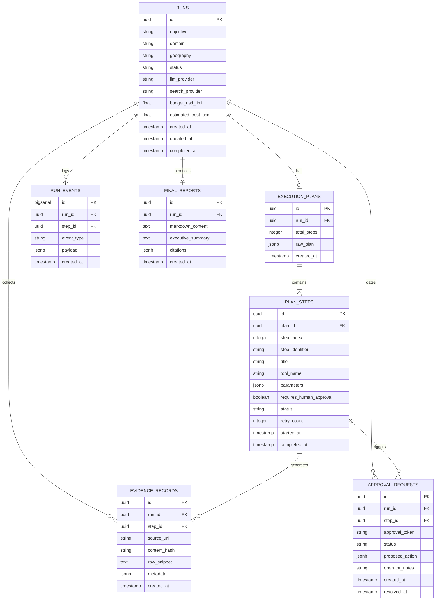

# Data Model & Persistence Architecture: AgentOps

## 1. Relational Entity-Relationship Diagram

---

## 2. Table Specifications & Schema Definitions

### 2.1 Table: `runs`
Tracks top-level research requests, operational lifecycle status, and cost metrics.

| Column | Type | Constraints | Description |
| :--- | :--- | :--- | :--- |
| `id` | `UUID` | Primary Key, default `gen_random_uuid()` | Unique identifier for the research run. |
| `objective` | `VARCHAR(2000)` | NOT NULL | Natural language analytical research objective. |
| `domain` | `VARCHAR(100)` | NOT NULL | Subject domain (e.g., `software`, `fintech`, `healthcare`). |
| `geography` | `VARCHAR(100)` | NULL | Geographical target scope (e.g., `North America`, `Global`). |
| `status` | `VARCHAR(50)` | NOT NULL, DEFAULT `'QUEUED'` | Enum: `QUEUED`, `PLANNING`, `RUNNING`, `AWAITING_APPROVAL`, `COMPLETED`, `COMPLETED_WITH_WARNINGS`, `FAILED`, `CANCELLED`, `ABORTED_BY_OPERATOR`. |
| `llm_provider` | `VARCHAR(50)` | NOT NULL, DEFAULT `'mock'` | Active LLM adapter: `mock`, `openai`, `ollama`. |
| `search_provider` | `VARCHAR(50)` | NOT NULL, DEFAULT `'mock'` | Active Search adapter: `mock`, `tavily`, `duckduckgo`. |
| `budget_usd_limit` | `NUMERIC(6, 4)` | NOT NULL, DEFAULT `1.0000` | Hard spending cap in USD. |
| `estimated_cost_usd` | `NUMERIC(6, 4)` | NOT NULL, DEFAULT `0.0000` | Cumulative tracked model execution cost. |
| `created_at` | `TIMESTAMPTZ` | NOT NULL, DEFAULT `NOW()` | Timestamp of run submission. |
| `updated_at` | `TIMESTAMPTZ` | NOT NULL, DEFAULT `NOW()` | Timestamp of last state mutation. |
| `completed_at` | `TIMESTAMPTZ` | NULL | Timestamp of final state transition. |

- **Indexes**:
  - `idx_runs_status` on `(status)`
  - `idx_runs_created_at` on `(created_at DESC)`

---

### 2.2 Table: `execution_plans`
Stores the validated execution plan synthesized by the planner node.

| Column | Type | Constraints | Description |
| :--- | :--- | :--- | :--- |
| `id` | `UUID` | Primary Key | Unique plan identifier. |
| `run_id` | `UUID` | NOT NULL, UNIQUE, FOREIGN KEY (`runs.id`) ON DELETE CASCADE | Associated run. |
| `total_steps` | `INTEGER` | NOT NULL, CHECK (`total_steps BETWEEN 1 AND 10`) | Total number of planned steps. |
| `raw_plan` | `JSONB` | NOT NULL | Serialized full plan JSON including dependencies. |
| `created_at` | `TIMESTAMPTZ` | NOT NULL, DEFAULT `NOW()` | Plan creation timestamp. |

---

### 2.3 Table: `plan_steps`
Represents an individual step in the execution plan.

| Column | Type | Constraints | Description |
| :--- | :--- | :--- | :--- |
| `id` | `UUID` | Primary Key | Unique step identifier. |
| `plan_id` | `UUID` | NOT NULL, FOREIGN KEY (`execution_plans.id`) ON DELETE CASCADE | Parent plan. |
| `step_index` | `INTEGER` | NOT NULL | Sequential 0-based order index. |
| `step_identifier`| `VARCHAR(50)` | NOT NULL | Human-readable tag (e.g., `step_search_competitors`). |
| `title` | `VARCHAR(255)` | NOT NULL | Descriptive title of the step objective. |
| `tool_name` | `VARCHAR(100)` | NOT NULL | Tool to execute: `web_search`, `fetch_document`, `extract_metrics`. |
| `parameters` | `JSONB` | NOT NULL, DEFAULT `'{}'` | Validated input arguments for the tool. |
| `requires_human_approval` | `BOOLEAN` | NOT NULL, DEFAULT `FALSE` | Halts state machine before execution if `TRUE`. |
| `status` | `VARCHAR(50)` | NOT NULL, DEFAULT `'PENDING'` | Enum: `PENDING`, `RUNNING`, `COMPLETED`, `FAILED`, `SKIPPED`. |
| `retry_count` | `INTEGER` | NOT NULL, DEFAULT `0` | Number of execution retries attempted. |
| `started_at` | `TIMESTAMPTZ` | NULL | Execution start timestamp. |
| `completed_at` | `TIMESTAMPTZ` | NULL | Execution completion timestamp. |

- **Indexes**:
  - `idx_plan_steps_plan_index` on `(plan_id, step_index)`

---

### 2.4 Table: `run_events`
Immutable event stream for real-time observability and post-run auditing.

| Column | Type | Constraints | Description |
| :--- | :--- | :--- | :--- |
| `id` | `BIGSERIAL` | Primary Key | Incremental event sequence number. |
| `run_id` | `UUID` | NOT NULL, FOREIGN KEY (`runs.id`) ON DELETE CASCADE | Target run. |
| `step_id` | `UUID` | NULL, FOREIGN KEY (`plan_steps.id`) ON DELETE SET NULL | Associated step, if applicable. |
| `event_type` | `VARCHAR(100)` | NOT NULL | Event tag (e.g., `STEP_STARTED`, `TOOL_CALLED`, `APPROVAL_REQUESTED`). |
| `payload` | `JSONB` | NOT NULL, DEFAULT `'{}'` | Event detail payload. |
| `created_at` | `TIMESTAMPTZ` | NOT NULL, DEFAULT `NOW()` | Event occurrence timestamp. |

- **Indexes**:
  - `idx_run_events_run_id` on `(run_id, id ASC)`

---

### 2.5 Table: `evidence_records`
Preserves empirical facts extracted from external tools for citation grounding.

| Column | Type | Constraints | Description |
| :--- | :--- | :--- | :--- |
| `id` | `UUID` | Primary Key | Unique evidence identifier. |
| `run_id` | `UUID` | NOT NULL, FOREIGN KEY (`runs.id`) ON DELETE CASCADE | Associated run. |
| `step_id` | `UUID` | NOT NULL, FOREIGN KEY (`plan_steps.id`) ON DELETE CASCADE | Originating step. |
| `source_url` | `VARCHAR(2048)` | NOT NULL | Permitted public URL or corpus identifier. |
| `content_hash` | `CHAR(64)` | NOT NULL | SHA-256 hash of `raw_snippet` for tamper verification. |
| `raw_snippet` | `TEXT` | NOT NULL | Unmodified text excerpt retrieved by tool. |
| `metadata` | `JSONB` | NOT NULL, DEFAULT `'{}'` | Publication date, author, or page title if present. |
| `created_at` | `TIMESTAMPTZ` | NOT NULL, DEFAULT `NOW()` | Retrieval timestamp. |

- **Indexes**:
  - `idx_evidence_run_id` on `(run_id)`
  - `idx_evidence_hash` on `(content_hash)`

---

### 2.6 Table: `approval_requests`
Governs human-in-the-loop (HITL) gates.

| Column | Type | Constraints | Description |
| :--- | :--- | :--- | :--- |
| `id` | `UUID` | Primary Key | Unique approval request identifier. |
| `run_id` | `UUID` | NOT NULL, FOREIGN KEY (`runs.id`) ON DELETE CASCADE | Associated run. |
| `step_id` | `UUID` | NOT NULL, FOREIGN KEY (`plan_steps.id`) ON DELETE CASCADE | Triggering step. |
| `approval_token`| `VARCHAR(128)` | NOT NULL, UNIQUE | Cryptographic URL-safe token. |
| `status` | `VARCHAR(50)` | NOT NULL, DEFAULT `'PENDING'` | Enum: `PENDING`, `APPROVED`, `REJECTED`, `EXPIRED`. |
| `proposed_action` | `JSONB` | NOT NULL | Summary and parameters of action requiring approval. |
| `operator_notes` | `TEXT` | NULL | Optional feedback provided by the operator. |
| `created_at` | `TIMESTAMPTZ` | NOT NULL, DEFAULT `NOW()` | Pause creation timestamp. |
| `resolved_at` | `TIMESTAMPTZ` | NULL | Timestamp of operator decision. |

---

### 2.7 Table: `final_reports`
Stores synthesized research reports with structured citation mappings.

| Column | Type | Constraints | Description |
| :--- | :--- | :--- | :--- |
| `id` | `UUID` | Primary Key | Unique report identifier. |
| `run_id` | `UUID` | NOT NULL, UNIQUE, FOREIGN KEY (`runs.id`) ON DELETE CASCADE | Target run. |
| `markdown_content` | `TEXT` | NOT NULL | Full generated Markdown report text. |
| `executive_summary`| `TEXT` | NOT NULL | High-level synthesis summary. |
| `citations` | `JSONB` | NOT NULL | Array mapping citation markers (e.g., `[^ev-1]`) to `evidence_id`. |
| `created_at` | `TIMESTAMPTZ` | NOT NULL, DEFAULT `NOW()` | Report generation timestamp. |

---

## 3. Database Connection & Migration Strategy

### 3.1 Dual-Engine Connection Model
- **FastAPI Gateway**: Uses `SQLAlchemy 2.0` with `asyncpg` for non-blocking asynchronous connection pooling:
  - Default pool size: 10 connections.
  - Max overflow: 20 connections.
  - Pool timeout: 30 seconds.
- **Celery Workers & Alembic**: Use standard synchronous `psycopg2-binary` engine for deterministic transactional task execution and migration scripts.

### 3.2 Migration Management (Alembic)
- All schema alterations are authored exclusively via versioned Alembic migration scripts located in `backend/alembic/versions/`.
- No application process applies automatic DDL changes on startup. Migrations are executed via standard CLI: `alembic upgrade head`.
- Every migration must provide reversible `upgrade()` and `downgrade()` routines.
