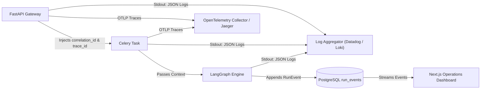

# Observability & Auditability Design: AgentOps

## 1. Observability Architecture

AgentOps implements a three-pillar observability strategy designed for distributed agentic architectures:
1. **Structured Contextual Logging**: Single-line JSON logs with unified correlation tags across API, Celery, and LangGraph.
2. **Distributed Tracing (OpenTelemetry)**: W3C Trace Context propagation across async Celery queues and database boundaries.
3. **Immutable Event Sourcing**: High-resolution PostgreSQL event store (`run_events`) powering the operations dashboard and compliance audits.



---

## 2. Structured JSON Logging Specification

All application logs emitted in standard operating mode conform to a standardized JSON schema:

```json
{
  "timestamp": "2026-10-20T10:35:12.104Z",
  "level": "INFO",
  "logger": "agentops.orchestration.executor",
  "message": "Tool execution succeeded",
  "run_id": "9b1deb4d-3b7d-4bad-9bdd-2b0d7b3dcb6d",
  "step_id": "c1f7b4e9-1111-2222-3333-444455556666",
  "correlation_id": "f5e4d3c2-b1a0-9876-5432-10fedcba9876",
  "tool_name": "fetch_document",
  "duration_ms": 142.8,
  "status": "COMPLETED"
}
```

### Context Binding Standards
- `correlation_id`: Created by FastAPI middleware upon request ingress; attached to `structlog.contextvars`.
- `run_id`: Bound at the start of Celery task execution and propagated through all subsequent logging calls.
- `step_id`: Injected dynamically by the LangGraph step execution loop.

---

## 3. Distributed Tracing with OpenTelemetry

When `OTEL_ENABLED=true`, the system instruments traces across the distributed components:

```
[Trace: 4bf92f3577b34da6a3ce929d0e0e4736]
|-- [Span: HTTP POST /api/v1/runs] (FastAPI, 12ms)
|   |-- [Span: DB Insert Run] (SQLAlchemy, 3ms)
|   +-- [Span: Celery Enqueue] (Redis, 2ms)
|
+-- [Span: Celery Task: execute_run] (Worker, 4200ms)
    |-- [Span: LangGraph: Planner] (LLM, 850ms)
    |-- [Span: Tool: web_search] (ToolRegistry, 620ms)
    |-- [Span: Tool: fetch_document] (ToolRegistry, 710ms)
    |-- [Span: LangGraph: HITL Pause & Resume] (Approval, 1200ms)
    +-- [Span: LangGraph: Synthesizer] (LLM, 820ms)
```

### Trace Header Propagation
- W3C `traceparent` headers are injected into the Celery task message metadata upon enqueueing.
- The Celery worker extracts the traceparent header before initializing the LangGraph state machine, establishing an unbroken trace hierarchy.

---

## 4. Audit Trail & Real-Time Event Stream

The PostgreSQL `run_events` table serves as an immutable operational audit log.

### Supported Event Types
- `RUN_QUEUED`: Run created and dispatched to worker queue.
- `PLAN_SYNTHESIZED`: Execution plan created by planner node.
- `PLAN_VALIDATED`: Tool allowlist and step DAG verified.
- `STEP_STARTED`: Worker initiates execution of a specific step.
- `TOOL_CALLED`: Tool invoked with sanitized parameters.
- `EVIDENCE_CAPTURED`: New empirical evidence recorded with content hash.
- `APPROVAL_REQUESTED`: Consequential action reached; state machine paused.
- `APPROVAL_RESOLVED`: Human operator submitted verdict (`approved` / `rejected`).
- `STEP_COMPLETED`: Step completed successfully.
- `STEP_RETRYING`: Transient error encountered; retrying step.
- `STEP_FAILED`: Step exhausted retries or failed fatally.
- `REPORT_SYNTHESIZED`: Final report created with verified citations.
- `RUN_COMPLETED`: Entire research workflow finished successfully.
- `SECURITY_VIOLATION`: Intercepted security violation (SSRF, unapproved tool).
