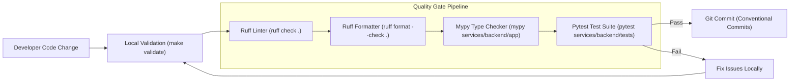

# Development Workflow & Quality Engineering Guide: AgentOps

## 1. Quality Engineering Standards Overview

AgentOps enforces strict engineering discipline across both backend Python services and frontend TypeScript applications. Quality checks are automated, deterministic, and runnable locally with zero external network dependencies.



---

## 2. Python Backend Tooling & Conventions

### 2.1 Formatting & Linting (Ruff)
- **Engine**: [Ruff](https://astral.sh/ruff) (v0.8+) replaces Black, Flake8, isort, and PyUpgrade with sub-second performance.
- **Standards**:
  - Python target: `py310`
  - Line length: `100` characters
  - Rules enabled: Pycodestyle (`E`, `W`), Pyflakes (`F`), isort (`I`), Bugbear (`B`), Comprehensions (`C4`), PyUpgrade (`UP`), Unused Arguments (`ARG`), Simplify (`SIM`).
- **Commands**:
  ```bash
  make lint        # Check for linting violations
  make lint-fix    # Automatically fix fixable issues
  make format      # Auto-format codebase
  make format-check# Verify code is formatted without modifications
  ```

### 2.2 Test Discovery & Pytest Markers
- **Directory Layout**:
  ```
  services/backend/tests/
  ├── conftest.py       # Shared fixtures (async_client, settings, db engine)
  ├── unit/             # In-memory unit tests (schemas, security, adapters)
  ├── integration/      # Multi-component tests with database and broker fixtures
  └── contract/         # OpenAPI schema and provider contract tests
  ```
- **Custom Markers**:
  All tests must adhere to explicit markers registered in `pyproject.toml`:
  - `@pytest.mark.unit`: Isolated in-memory tests running without containers.
  - `@pytest.mark.integration`: Tests requiring live PostgreSQL or Redis.
  - `@pytest.mark.contract`: Schema and API input/output validation tests.
  - `@pytest.mark.security`: SSRF and parameter injection security tests.
  - `@pytest.mark.e2e`: Full research pipeline replay tests in Mock mode.
- **Strict Marker Enforcement**: `addopts = "-ra -q --strict-markers"` ensures that unregistered markers raise an immediate error.

### 2.3 Static Type Checking (Mypy)
- **Engine**: Mypy with strict configuration.
- **Policy**:
  - `disallow_untyped_defs = true`: Every function must have explicit parameter and return type annotations.
  - `check_untyped_defs = true`: Deep inspection of all function bodies.
  - `no_implicit_optional = true`: Arguments that can be `None` must be explicitly typed as `Type | None`.
  - `plugins = ["pydantic.mypy"]`: Ensures Pydantic v2 model attributes are statically validated.
- **Execution**:
  ```bash
  make type-check   # Runs mypy services/backend/app
  ```

### 2.4 Layer Separation & Circular Import Prevention
To prevent architectural degradation, code imports follow a strict downward hierarchy:
```
[api/v1/routes]       -> Depends on: services, schemas, core
      |
      v
[services]            -> Depends on: repositories, agents, tools, providers, schemas
      |
      v
[agents / tools]      -> Depends on: providers, schemas, core
      |
      v
[repositories / db]   -> Depends on: models, schemas, core
      |
      v
[models / schemas]    -> Depends on: core
      |
      v
[core]                -> Standalone (config, security, logging)
```
- **Rule**: Lower layers never import from upper layers. For example, `models` and `schemas` never import from `api` or `services`.

---

## 3. Frontend Tooling & Conventions (`apps/web`)

### 3.1 TypeScript Strict Mode
- Configured in [`apps/web/tsconfig.json`](file:///Users/macbook/Downloads/Github_repo/agentops/apps/web/tsconfig.json) with all strict compiler flags enabled:
  - `"strict": true`
  - `"noImplicitAny": true`
  - `"strictNullChecks": true`
  - `"noUncheckedIndexedAccess": true`
  - `"noImplicitOverride": true`

### 3.2 Component Architecture & Naming
- **Atomic UI Components** (`components/ui/`): Stateless, generic design system primitives (Button, Modal, Card, Badge).
- **Feature Components** (`features/`): Domain-scoped components (e.g., `features/plan-inspector/`, `features/evidence-drawer/`, `features/hitl-modal/`).
- **Rule on Business Logic**: UI components must remain presentational. Validation schemas and state transition logic must live in typed client models (`lib/api.ts`) rather than buried in JSX event handlers.

---

## 4. Quality Gate & Makefile Workflow

The primary entry point for developers is the project [`Makefile`](file:///Users/macbook/Downloads/Github_repo/agentops/Makefile):

| Target | Command | Purpose |
| :--- | :--- | :--- |
| `make help` | `make help` | Display all available targets. |
| `make install` | `pip install -e ".[dev]"` | Install backend dependencies in virtual environment. |
| `make lint` | `ruff check .` | Run static linting analysis. |
| `make format` | `ruff format .` | Auto-format backend Python files. |
| `make type-check` | `mypy services/backend/app` | Run static type checking. |
| `make test` | `pytest services/backend/tests` | Execute test suite. |
| `make validate` | `make lint format-check type-check test` | Run complete quality gate before committing. |
| `make up` | `docker compose -p agentops up -d` | Start containerized services. |
| `make down` | `docker compose -p agentops down` | Stop containerized services. |
| `make clean` | `find ... rm` | Remove temporary cache and bytecode files. |

---

## 5. Development Troubleshooting Guide

### 5.1 Port Allocation Conflicts
- **Symptom**: `Bind for 0.0.0.0:8000 failed: port is already allocated`.
- **Diagnosis**: Another process or workspace is listening on the port.
- **Resolution**:
  1. Check allocated ports in [`AGENTS.md`](file:///Users/macbook/Downloads/Github_repo/agentops/AGENTS.md): Frontend (`3000`), Backend (`8000`), PostgreSQL (`5432`), Redis (`6379`), n8n (`5678`).
  2. Inspect listening processes: `lsof -i :8000`.
  3. **Strict Constraint**: Never kill processes on forbidden ports (`8080`, `5433`, `6380`, `6333`). Only terminate PIDs belonging to this workspace.

### 5.2 Celery Worker Fork Safety on macOS Host
- **Symptom**: `SIGABRT` or crash referencing `CoreFoundation` when running Celery on a Mac host.
- **Diagnosis**: macOS restricts calling multithreaded APIs inside processes created via `fork`.
- **Resolution**: When running Celery directly on macOS outside Docker, use threads or solo pool:
  ```bash
  celery -A app.workers.celery_app worker --loglevel=info --pool=threads --concurrency=2
  ```

### 5.3 PostgreSQL / Redis Connection Refused
- **Symptom**: `asyncpg.exceptions.CannotConnectNowError: connection to 127.0.0.1:5432 failed`.
- **Resolution**:
  1. Ensure containers are up: `docker compose -p agentops ps`.
  2. Inspect health: `docker compose -p agentops exec postgres pg_isready -U agentops_user -d agentops_db`.
  3. Verify `.env` matches [`compose.yaml`](file:///Users/macbook/Downloads/Github_repo/agentops/compose.yaml) credentials.

### 5.4 DNS Resolution Failures in Sandboxed Test Runs
- **Symptom**: Test fails attempting external network socket creation.
- **Diagnosis**: Sandbox isolation blocks outbound internet access.
- **Resolution**: Ensure `LLM_PROVIDER=mock` and `SEARCH_PROVIDER=mock` are active. AgentOps test suites are designed to pass 100% offline using the mock adapter layer.
