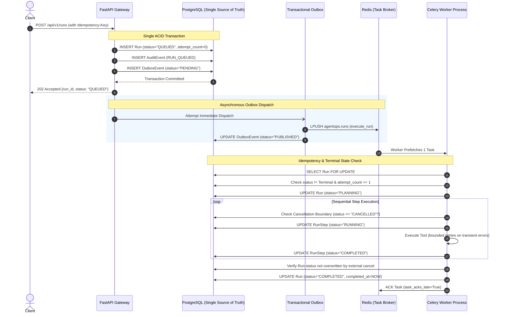
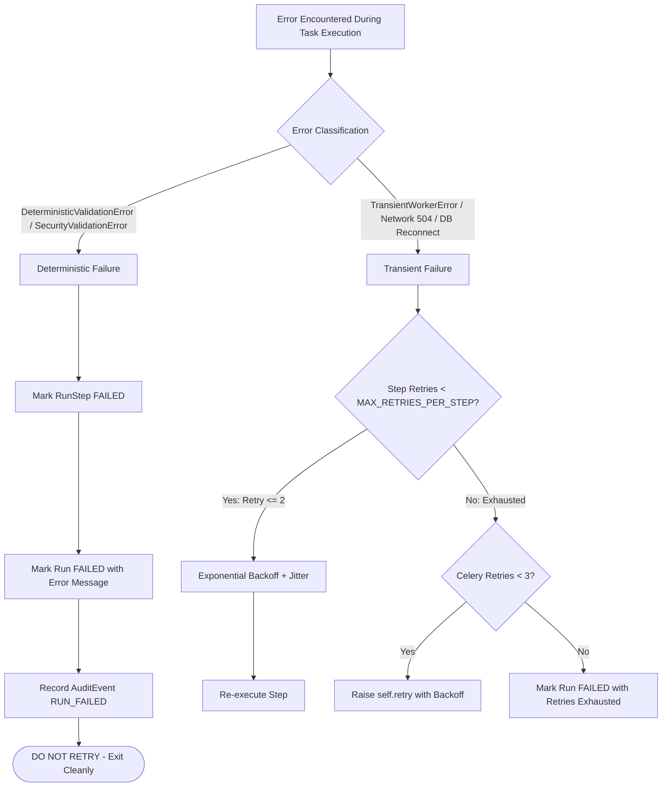

# Durable Asynchronous Execution & Recovery Guarantees: AgentOps

## 1. Executive Architecture Summary

AgentOps employs an asynchronous background task processing pipeline orchestrated with **Celery 5.6+**, **Redis 7.2+**, and **PostgreSQL 16+**. 

The fundamental architectural principle is:
> **A run is never reported as successful merely because a job message was published to a queue.**  
> Successful completion is strictly tied to persisted database domain states, validated execution checkpoints, and auditable outputs.



---

## 2. The Transactional Outbox Pattern

### 2.1 The Distributed Dual-Write Problem
In naive architectures, web applications write to a database and then immediately publish an event to a message broker. This creates an unrecoverable failure window:
- If the broker is unreachable or network packets drop *after* the database commit, the job is silently lost forever.
- If the application writes to the broker *before* committing to the database, a database failure causes the worker to execute a phantom run that does not exist in persistent storage.

### 2.2 AgentOps Outbox Solution
In AgentOps, every `POST /api/v1/runs` request executes a single ACID transaction containing:
1. The `Run` record with status `QUEUED`.
2. An immutable `AuditEvent` (`RUN_QUEUED`).
3. An `OutboxEvent` with status `PENDING` and payload `{"run_id": "...", "correlation_id": "..."}`.

Once committed, the run is mathematically protected against silent loss:
- **Fast-path dispatch**: A FastAPI `BackgroundTask` attempts immediate publication to Celery in `< 5ms`.
- **Fault-tolerant fallback**: If Redis is temporarily down during publication, the API still succeeds with `HTTP 202 Accepted`. The outbox event remains `PENDING` in PostgreSQL with incremented `retry_count` and `last_error`.
- **Sweeper reconciliation**: Periodic sweeps and worker startup routines (`dispatch_pending_outbox_sync`) poll `outbox_events` and republish unacknowledged tasks once connectivity resumes.

---

## 3. Celery Delivery Semantics: At-Least-Once vs. "Exactly-Once"

### 3.1 The Physical Reality of Distributed Messaging
In accordance with distributed systems theory (e.g., the Two Generals Problem and FLP Impossibility), **exactly-once external message delivery does not exist** across network boundaries.

AgentOps explicitly acknowledges and designs for **At-Least-Once Delivery**:
- Messages can be duplicated during network partitions, broker reconnection spikes, or unacknowledged worker crashes.
- Therefore, durability and consistency **must be enforced by the application domain layer through idempotent execution**.

### 3.2 Celery Configuration Profile
To guarantee zero message loss during worker process crashes, AgentOps pins the following Celery settings in `app.workers.celery_app`:

| Setting | Value | Rationale |
| :--- | :--- | :--- |
| `task_acks_late` | `True` | Celery acknowledges the message **only after** task execution finishes. If a worker process is killed (`SIGKILL`, OOM, power loss) mid-task, the unacknowledged message is returned to Redis and redelivered. |
| `task_reject_on_worker_lost` | `True` | Forces rejection (and subsequent broker redelivery) if the worker child process abruptly terminates or exits with a non-zero code. |
| `worker_prefetch_multiplier` | `1` | Disables task hoarding; each worker slot pulls only 1 task at a time, preventing task starvation when long-running research jobs are in flight. |
| `task_soft_time_limit` | `300s` | Raises `SoftTimeLimitExceeded` inside Python so the task can clean up, mark the run as `FAILED`, and record audit trails before hard termination. |
| `task_time_limit` | `330s` | Hard OS-level SIGKILL limit if a process is locked in unmanaged C extensions or deadlocked sockets. |

---

## 4. Idempotency & Duplicate Delivery Safeguards

Because `task_acks_late=True` redelivers tasks upon worker crash, a task may arrive more than once. AgentOps enforces three defensive layers to prevent duplicate logical runs:

### Layer 1: API Gateway Idempotency Key
- Clients submit an optional `idempotency_key` (UUID or unique client identifier).
- If a subsequent request arrives with the same key and identical objective, the API returns the existing `Run` (`HTTP 202`) and **does not create a duplicate outbox event or Celery task**.
- If a subsequent request arrives with the same key but a conflicting objective, the API rejects it immediately with `HTTP 409 Conflict`.

### Layer 2: Terminal State Guard
- When `execute_run` begins, it queries the current `Run` record.
- If `run.status` is in a terminal state (`COMPLETED`, `COMPLETED_WITH_WARNINGS`, `CANCELLED`, `FAILED`, `ABORTED_BY_OPERATOR`), the task logs a structured notice (`duplicate_delivery_ignored`) and exits immediately with `SKIPPED_DUPLICATE_DELIVERY`.
- It does not modify steps, re-invoke tools, or overwrite timestamps.

### Layer 3: Paused Approval Gate Guard
- If `run.status == RunStatus.AWAITING_APPROVAL`, duplicate deliveries exit immediately with `SKIPPED_AWAITING_APPROVAL`, preserving the integrity of the Human-in-the-Loop gate.

---

## 5. Stale Worker & Terminal State Protection

In distributed systems, a "stale worker" (e.g., a worker experiencing a GC pause or slow network) might wake up and attempt to write its results *after* an operator has already cancelled the run or another worker has marked it failed.

AgentOps prevents state clobbering via **Terminal State Checks before Finalization**:
```python
# Before committing final COMPLETED status:
run = session.execute(select(Run).where(Run.id == run_uuid)).scalar_one()

if run.status in TERMINAL_RUN_STATUSES:
    logger.warning(
        "stale_worker_terminal_state_protected", run_id=run_id, current_status=run.status.value
    )
    return {"status": "SKIPPED_TERMINAL_PROTECTED", "run_id": run_id}

run.status = RunStatus.COMPLETED
```
If an operator cancelled the run while a step was executing, the run remains `CANCELLED`; the worker's late write is discarded.

---

## 6. Cancellation at Safe Execution Boundaries

Cancellation (`POST /api/v1/runs/{run_id}/cancel`) operates cooperatively and safely:
1. The API transitions `Run.status` to `CANCELLED` in PostgreSQL and records an audit log.
2. The worker checks `run.status` at discrete execution boundaries:
   - Prior to initial planning.
   - Immediately before each plan step begins.
3. If `run.status == RunStatus.CANCELLED`:
   - Execution halts immediately.
   - Any unexecuted pending steps are marked `SKIPPED`.
   - The worker returns `CANCELLED_AT_BOUNDARY` and commits cleanly.
   - External tools are never invoked for subsequent steps.

---

## 7. Error Classification & Bounded Retries

AgentOps cleanly separates errors into two distinct categories:



### Deterministic Errors (Never Retried)
- Security policy violations (SSRF attempts to internal IPs, unapproved tools).
- Schema validation failures.
- Non-existent resource references.
- These fail immediately, saving computational resources and avoiding log flooding.

### Transient Errors (Bounded Exponential Backoff)
- Socket connection drops.
- Rate limits (HTTP 429).
- Upstream server errors (HTTP 502/503/504).
- Retried up to `MAX_RETRIES_PER_STEP` (default: 2) at the step level, and up to `max_retries=3` at the Celery task level.

---

## 8. Startup Reconciliation Protocol (Orphan Discovery)

If a host experiences an abrupt power loss or a worker process is terminated via `SIGKILL` (out-of-memory killer):
- The in-flight run remains in `RUNNING` or `PLANNING` status.
- The startup recovery service (`app.services.recovery_service.reconcile_interrupted_runs`) runs on worker or API initialization:
  1. Identifies runs in active states whose `updated_at` timestamp is older than `stale_threshold_seconds` (default: 300s).
  2. Transitions these runs to `FAILED` with an explicit reason: `"Execution interrupted: worker process lost or terminated unexpectedly..."`.
  3. Transitions any active `RUNNING` steps to `FAILED`.
  4. Appends an `AuditEvent` (`actor="recovery_service"`).
  5. Sweeps and publishes any `PENDING` outbox events.

This guarantees that restarting the platform resolves all zombie runs and resumes pending work cleanly.

---

## 9. Dependency Outage Resilience Matrix

| Outage Scenario | System Behavior & Guarantees |
| :--- | :--- |
| **Redis Broker Down** | - API continues accepting runs and committing them durably to PostgreSQL.<br>- Outbox events record `last_error="OperationalError"` and remain `PENDING`.<br>- Readiness probe `/health/ready` returns `503 Service Unavailable`.<br>- When Redis recovers, the outbox sweeper dispatches all accumulated tasks. |
| **PostgreSQL Down** | - API immediately rejects incoming requests with `503 Service Unavailable`, preventing unpersisted job ingestion.<br>- Celery workers encountering DB disconnects raise retriable errors with exponential backoff.<br>- No state is updated without verified database transaction commits. |
| **Worker Process Crash (SIGKILL)** | - Task message remains unacknowledged in Redis (`task_acks_late=True`).<br>- Redis redelivers the message to a healthy worker slot.<br>- The receiving worker checks DB state and resumes execution idempotently. |
| **Worker Graceful Shutdown (SIGTERM)** | - Celery signal `worker_shutting_down` sets internal shutdown flag.<br>- Worker finishes current in-flight database transaction before terminating child process.<br>- Pending steps in the loop are paused cleanly. |

---

## 10. Known Limitations of the Celery + Redis Setup

While this architecture provides enterprise-grade durability for a self-hosted platform, the following inherent limitations of the Celery/Redis pairing are documented:

1. **Redis In-Memory Persistence Constraints**:
   - Redis functions as a task queue using memory lists/streams. While Redis Append-Only File (AOF) persistence is enabled in AgentOps Compose configuration (`appendonly yes`), a catastrophic power loss before an AOF fsync could drop unacknowledged messages in Redis.
   - *Mitigation in AgentOps*: The PostgreSQL `outbox_events` table is the durable source of truth. If Redis were flushed completely, the startup outbox sweeper can replay all uncompleted jobs from PostgreSQL.
2. **Cooperative Cancellation Boundary**:
   - Celery `revoke(terminate=True)` issues a SIGTERM/SIGKILL to worker processes, which can interrupt database transactions mid-flight.
   - *Design Choice in AgentOps*: AgentOps uses **cooperative boundary checking** (`Run.status == CANCELLED`) between steps rather than abrupt process termination. This guarantees clean step states, but means an in-progress external network call must complete or hit its per-step timeout (default: 60s) before cancellation is acknowledged.
3. **No Distributed Saga Rollback for External Side Effects**:
   - If an external tool has already performed a non-idempotent side effect (e.g., sent a webhook notification), rolling back the local run does not un-send the external network packet.
   - *Mitigation in AgentOps*: Consequential side effects are gated behind the Human-in-the-Loop (`AWAITING_APPROVAL`) gate before execution.
