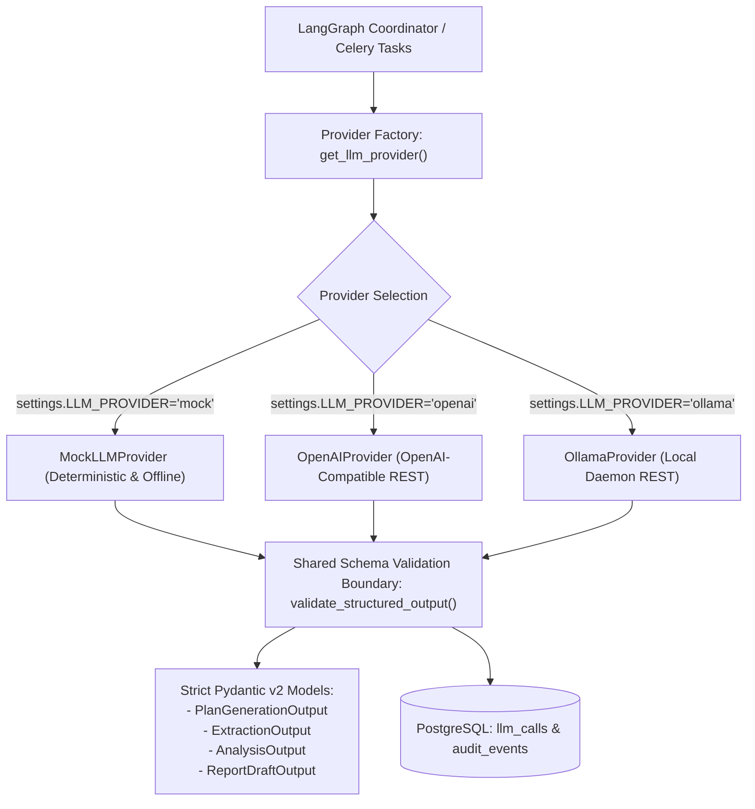

# LLM Provider Abstraction & Structured Generation: AgentOps

## 1. Architectural Principles

AgentOps enforces strict decoupling between high-level autonomous agent orchestration and external model providers (e.g., OpenAI, Ollama, local weights):



### Core Architecture Invariants:
1. **Zero SDK Leakage**: Core application logic and agent graphs depend exclusively on `BaseLLMProvider` and typed Pydantic v2 domain schemas (`PlanGenerationOutput`, `ExtractionOutput`, `AnalysisOutput`, `ReportDraftOutput`). Vendor-specific SDK objects (`openai.types.*`, `langchain.*`) are strictly prohibited from crossing the provider boundary.
2. **Deterministic-by-Default (Mock Mode)**: The platform functions 100% offline with zero external network calls or paid API keys using `MockLLMProvider`. Continuous integration (CI) tests execute against seeded deterministic mock responses.
3. **HTTP REST Over Heavy Client SDKs**: Network-based providers (`OpenAIProvider`, `OllamaProvider`) communicate over standard HTTP/1.1 and HTTP/2 via `httpx`, adhering to the Least Dependency Principle and avoiding SDK version churn.
4. **Shared Validation Boundary**: Raw model completions pass through `validate_structured_output()`, which strips markdown fences, parses JSON, and performs strict Pydantic constraint validation before returning data to the application.
5. **Auditable Token & Cost Accounting**: Every model call records token counts (`prompt_tokens`, `completion_tokens`, `total_tokens`), latency in milliseconds, and estimated cost in USD into the `llm_calls` table and structured logs.
6. **Prompt Privacy & Secret Redaction**: Full raw prompts and API keys (`Bearer sk-...`) are never written to unencrypted logs; previews are sanitized and bounded.

---

## 2. Required Model Capabilities & Schemas

| Capability | Pydantic Schema | Input Context | Output Guarantee |
| :--- | :--- | :--- | :--- |
| **Plan Generation** | `PlanGenerationOutput` | Natural language objective, domain, optional geography, constraints. | Bounded sequence of `PlanStepDefinition` referencing approved tools (`web_search`, `fetch_document`, `extract_metrics`). |
| **Information Extraction** | `ExtractionOutput` | Unstructured text, competitor web page snippets. | Extracted competitor name, `products` list, pricing model, target customers, and empirical assertions. |
| **Analysis Generation** | `AnalysisOutput` | Structured empirical findings across competitors. | Comparative matrix of strengths, weaknesses, market positioning, and strategic inferences. |
| **Report Drafting** | `ReportDraftOutput` | Objective, analysis matrix, verified evidence records. | Executive summary, grounded evidence section (`## Empirical Findings`), strategic inference section (`## Strategic Inferences`), and complete Markdown content. |

---

## 3. Provider Adapter Implementations

### 3.1 MockLLMProvider (Default & Testing)
- **Class**: `app.providers.mock.MockLLMProvider`
- **Configuration**: `LLM_PROVIDER=mock`, `MOCK_DETERMINISTIC_SEED=42`.
- **Characteristics**:
  - Requires zero internet connection and zero external credentials.
  - Generates bit-for-bit identical outputs when initialized with the same random seed.
  - Returns realistic competitor intelligence profiles for software, platform engineering, and AI developer tools.
  - Supports testing failure modes via constraint flags (`__test_fail_timeout__`, `__test_fail_malformed__`).

### 3.2 OpenAIProvider (External API)
- **Class**: `app.providers.openai.OpenAIProvider`
- **Configuration**:
  - `OPENAI_API_KEY`: Required bearer token.
  - `OPENAI_MODEL_NAME`: Default `gpt-4o-mini` (or `gpt-4o`, `o1-mini`).
  - `OPENAI_API_BASE`: Default `https://api.openai.com/v1` (supports custom gateways, vLLM, LiteLLM, Groq).
  - `LLM_REQUEST_TIMEOUT_SECONDS`: Default `30.0` seconds.
- **Structured Output Strategy**:
  - Issues `POST /chat/completions` with `response_format={"type": "json_object"}`.
  - System prompt injects the exact target Pydantic JSON Schema (`schema.model_json_schema()`).
- **Token Cost Accounting**:
  - `gpt-4o-mini`: \$0.150 per 1M prompt tokens; \$0.600 per 1M completion tokens.
  - `gpt-4o`: \$2.500 per 1M prompt tokens; \$10.000 per 1M completion tokens.
  - Real-time cost is calculated and accumulated on the `Run.estimated_cost_usd` database record.

### 3.3 OllamaProvider (Local Offline LLM)
- **Class**: `app.providers.ollama.OllamaProvider`
- **Configuration**:
  - `OLLAMA_BASE_URL`: Default `http://127.0.0.1:11434`.
  - `OLLAMA_MODEL_NAME`: Default `llama3.2` (or `mistral`, `qwen2.5`).
  - `LLM_REQUEST_TIMEOUT_SECONDS`: Default `60.0` seconds.
- **Structured Output Strategy**:
  - Issues `POST /api/chat` with `format="json"`, `stream=False`.
  - Automatically translates Ollama's `total_duration` (nanoseconds) to milliseconds.
  - Cost is recorded as \$0.000000.

---

## 4. Error Classification & Resilience Matrix

Every provider adapter translates low-level transport anomalies into standardized AgentOps domain exceptions:

| Condition / Status Code | Exception Raised | Celery / Runner Action |
| :--- | :--- | :--- |
| **Missing API Key** | `AuthenticationError` | Fails immediately. Terminal status `FAILED`. Not retried. |
| **Rate Limited (HTTP 429)** | `TransientWorkerError` | Retries with exponential backoff honoring `Retry-After`. |
| **Request Timeout** | `TransientWorkerError` | Retried up to `MAX_RETRIES_PER_STEP`. |
| **Upstream 5xx Server Error** | `TransientWorkerError` | Retried up to `MAX_RETRIES_PER_STEP`. |
| **Bad Request 4xx / Model Not Found 404** | `DeterministicValidationError` | Fails immediately. Terminal status `FAILED`. Not retried. |
| **Malformed JSON / Schema Constraint Violation** | `DeterministicValidationError` | Fails immediately. Details logged in `AuditEvent`. Not retried. |
| **Ollama Daemon Down / Connection Refused** | `ServiceUnavailableError` | Fails gracefully or triggers worker reconnect backoff. |

---

## 5. Explicit Provider Selection (`get_llm_provider`)

Applications instantiate providers through the centralized factory:
```python
from app.providers import get_llm_provider

# 1. Environment-default provider (mock in dev/test, openai or ollama in live)
provider = get_llm_provider()

# 2. Explicit provider override with custom model and parameters
provider = get_llm_provider(
    provider_name="openai",
    model_name="gpt-4o-mini",
    api_key="sk-...",
    timeout=45.0,
)
```

The factory guarantees that any returned object satisfies `BaseLLMProvider`.

---

## 6. Provider Capabilities & Known Limitations Matrix

| Feature / Dimension | MockLLMProvider | OpenAIProvider | OllamaProvider |
| :--- | :--- | :--- | :--- |
| **Cost** | \$0.00 (Zero cost) | Paid per-token API | \$0.00 (Local compute) |
| **External Network** | 0% (Fully offline) | Requires Internet | 0% (Local daemon) |
| **CI / Hermetic Suitability** | Excellent (Bit-for-bit reproducible) | Unsuitable (Variable latency/cost) | High (Requires local daemon in runner) |
| **Structured Output Reliability** | 100% Guaranteed | Very High (`json_object` + schema) | High (Depends on model parameter size) |
| **Known Limitations** | Limited to pre-seeded research scenarios; cannot discover novel live entities. | Subject to external API outages, rate limits, and network latency. | Inference latency depends on local host GPU/RAM; small models (<7B) may occasionally produce schema deviations. |
