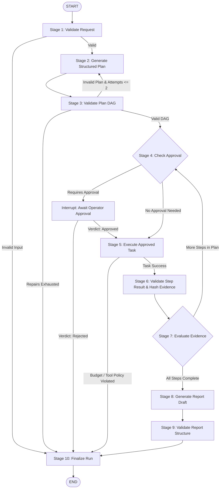

# Bounded LangGraph Agent Runtime & State Lifecycle: AgentOps

## 1. Executive Summary & Graph Architecture

The AgentOps Agent Runtime is a deterministic, bounded state machine built on **LangGraph 1.2+** and **LangGraph Checkpoint 4.3+**. 

The runtime enforces an invariant security boundary:
> **Unbounded loops, arbitrary code execution, and unvalidated LLM parameters are mathematically impossible by design.**  
> Every execution branch terminates in a verified domain state (`COMPLETED`, `COMPLETED_WITH_WARNINGS`, `FAILED`, `ABORTED_BY_OPERATOR`) or a deliberate, checkpointer-backed Human-in-the-Loop wait.



---

## 2. The 10 Execution Stages

| Stage | Node Function | Primary Responsibility | Failure / Branch Guard |
| :--- | :--- | :--- | :--- |
| **1. Validate Request** | `validate_request_node` | Validates objective length (10–2000 chars), domain, and initializes budget counters. | Halts to `finalize_run` (`FAILED`) on invalid inputs. |
| **2. Generate Plan** | `generate_plan_node` | Calls LLM provider to synthesize sequential steps adhering to `PlanGenerationOutput`. | Passes previous validation errors if repairing plan. |
| **3. Validate Plan** | `validate_plan_node` | Enforces max steps, unique IDs, tool allowlist, dependency existence, and runs Kahn's topological sort. | Loops to `generate_plan` if repairs remaining; otherwise terminates `FAILED`. |
| **4. Check Approval (HITL)** | `check_approval_node` | Inspects `requires_human_approval`. If `True`, calls `langgraph.types.interrupt`. | Pauses execution cleanly; aborts to `ABORTED_BY_OPERATOR` if rejected. |
| **5. Execute Task** | `execute_task_node` | Invokes allowlisted tool (`web_search`, `fetch_document`, `extract_metrics`) with SSRF guards. | Rejects any unapproved task type; enforces step & financial budgets. |
| **6. Validate Result** | `validate_step_result_node` | Validates tool output and appends evidence record with SHA-256 hash. | Records fatal error if critical step fails without data. |
| **7. Evaluate Evidence** | `evaluate_evidence_node` | Evaluates if additional plan steps remain or if evidence collection is complete. | Loops to `check_approval` for next step, or advances to report synthesis. |
| **8. Generate Report** | `generate_report_node` | Calls LLM provider with collected evidence to draft markdown report. | Propagates provider errors cleanly to state. |
| **9. Validate Report** | `validate_report_node` | Verifies presence of grounded findings, inferences, and minimum length. | Appends non-fatal warnings to `errors` list. |
| **10. Finalize Run** | `finalize_run_node` | Maps execution results to terminal status (`COMPLETED`, `COMPLETED_WITH_WARNINGS`, `FAILED`, `ABORTED_BY_OPERATOR`). | Resolves all state counters and terminates graph at `END`. |

---

## 3. Typed State Schema (`AgentState`)

The graph operates on an immutable, strongly-typed dictionary conforming to `app.agents.state.AgentState`:

```python
class AgentState(TypedDict, total=False):
    # 1. Run identifiers
    run_id: str
    correlation_id: str | None

    # 2. Validated user request
    objective: str
    domain: str
    geography: str | None
    constraints: dict[str, Any]

    # 3. Provider selection
    llm_provider: str
    search_provider: str

    # 4. Execution plan
    plan: list[dict[str, Any]]
    plan_rationale: str | None
    total_steps: int

    # 5. Current step execution pointers
    current_step_index: int
    current_step: dict[str, Any] | None

    # 6. Step inputs and outputs
    step_results: dict[str, Any]

    # 7. Evidence references
    evidence_items: list[dict[str, Any]]

    # 8. Budget counters & resource bounds
    steps_executed: int
    max_steps: int
    cost_usd: float
    budget_limit_usd: float
    plan_repair_attempts: int
    max_plan_repairs: int

    # 9. Error summaries
    errors: list[str]
    fatal_error: str | None

    # 10. Approval state (Human-in-the-Loop)
    approval_required: bool
    approval_id: str | None
    approval_status: str | None
    approval_token: str | None
    approval_action: dict[str, Any] | None

    # 11. Final report reference & lifecycle status
    final_report: dict[str, Any] | None
    status: str
```

---

## 4. Planner DAG Validation & Cycle Detection

Plans generated by LLM providers are untrusted strings until validated by `app.agents.planner.validate_plan_dag`:

1. **Step Count Bound**: Enforces $1 \le N \le \text{MAX\_PLAN\_STEPS}$ (default 10).
2. **Identifier Uniqueness**: Each step must supply a unique non-empty `step_identifier`.
3. **Allowlisted Tools Only**: `tool_name` must exist in `ALLOWED_TASK_TYPES = {"web_search", "fetch_document", "extract_metrics"}`. Any hallucinated tool (e.g. `execute_shell`, `bash`, `python_eval`) triggers immediate rejection.
4. **Valid Dependency References**: Every entry in `dependencies` must reference a valid `step_identifier` in the current plan. Self-dependencies ($A \to A$) are rejected.
5. **Cycle Detection via Kahn's Algorithm**:
   - Calculates in-degrees for all plan step nodes.
   - Computes topological ordering using a queue of zero-in-degree nodes.
   - If visited nodes $< \text{total nodes}$, a circular dependency ($A \to B \to A$) is detected and rejected.

---

## 5. Bounded Plan Repair Loop

To prevent infinite planning loops while tolerating occasional model schema mistakes:
- The graph maintains a strict counter: `plan_repair_attempts`.
- If a plan has cycles or references unapproved tools, `validate_plan_node` increments `plan_repair_attempts`.
- If $\text{plan\_repair\_attempts} \le \text{max\_plan\_repairs}$ (default: 2), the graph routes back to `generate_plan_node` with feedback.
- If $\text{plan\_repair\_attempts} > \text{max\_plan\_repairs}$, the repair budget is exhausted, and the run terminates with `status="FAILED"`.

---

## 6. Zero Arbitrary Code Execution Policy

AgentOps strictly rejects the "code interpreter" paradigm for research operations:
- No `eval()`, `exec()`, `os.system()`, or `subprocess` calls exist in the runtime.
- Model parameters are never passed to shell interpreters.
- HTTP requests issued by `fetch_document` are guarded by `is_safe_url` to prevent SSRF against loopback (`127.0.0.1`), private subnets (`10.0.0.0/8`, `192.168.0.0/16`), and cloud metadata (`169.254.169.254`).

---

## 7. Human-in-the-Loop (HITL) via LangGraph `interrupt()`

When a plan step specifies `requires_human_approval: True`:
1. `check_approval_node` invokes LangGraph's native `interrupt()` function with step metadata.
2. The LangGraph engine pauses execution and captures an immutable checkpoint to storage (`MemorySaver` in local memory or PostgreSQL checkpointer in production).
3. The API client or operator receives an approval required notice.
4. When the operator submits their decision via the API (`POST /api/v1/approvals/{id}/approve`), the runtime resumes the graph using:
   ```python
   graph.invoke(Command(resume={"verdict": "approved"}), config=config)
   ```
5. If approved, execution advances to `execute_task_node`. If rejected, execution transitions cleanly to `status="ABORTED_BY_OPERATOR"`.

---

## 8. Resource & Budget Safeguards

Before each task step executes, `execute_task_node` verifies:
- `steps_executed < max_steps` (hard ceiling on loop execution).
- `cost_usd < budget_limit_usd` (financial token expenditure cap).

If either ceiling is reached, execution halts immediately with a descriptive fatal error and finalizes cleanly without runaway charges.
