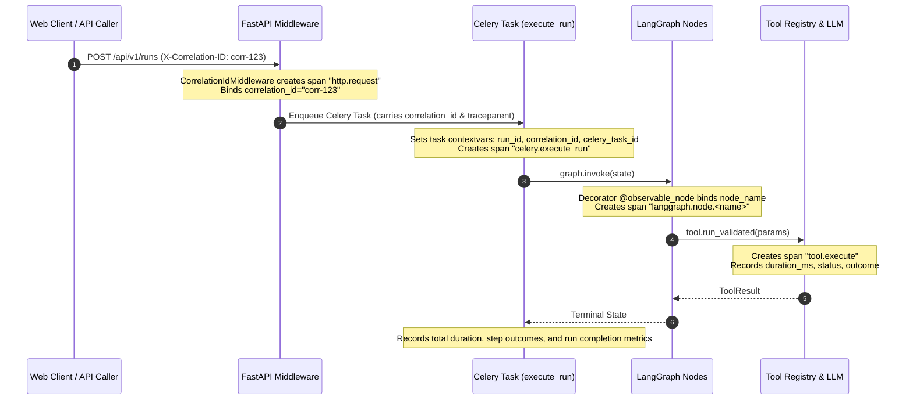

# Phase 19: AgentOps Observability & Distributed Telemetry

## 1. Architectural Overview

AgentOps implements an enterprise-grade, privacy-preserving, and OpenTelemetry-compatible observability architecture designed for autonomous agent execution. The platform guarantees that every analytical run, background task, tool invocation, and human approval decision is transparent, traceable, and debuggable without leaking confidential operator secrets or customer data.

The observability system rests on three distinct, coordinated pillars:

1. **Structured Contextual JSON Logging**: Every log entry is emitted as a single-line, standardized JSON record enriched with active correlation identifiers (`correlation_id`, `run_id`, `step_id`, `celery_task_id`, `node_name`, `tool_name`).
2. **OpenTelemetry-Compatible Distributed Tracing**: Standards-compliant W3C `traceparent` propagation connects async Celery queues, database commits, and LangGraph node executions into unbroken distributed trace trees. Telemetry export is strictly optional, degrading gracefully to local in-memory no-op tracers without external cloud dependencies.
3. **Immutable Operational Audit Trail & Honest Metrics**: Relational persistence in PostgreSQL (`audit_events` and `llm_calls`) captures compliance-grade state transitions, while a thread-safe metrics registry provides honest, verifiable counters, gauges, and percentile histograms with explicit disclosure of approximations.

```mermaid
flowchart TD
    Client["Client / Web UI / n8n"] -->|1. HTTP Ingress + X-Correlation-ID| Gateway["FastAPI API Gateway"]
    
    subgraph Gateway ["FastAPI Gateway"]
        Middleware["CorrelationIdMiddleware"]
        Tracer["OpenTelemetry Tracer"]
        LogRedactor["Log Redactor & Size Bounding"]
    end

    Middleware -->|2. Binds ContextVars| DB[("PostgreSQL")]
    Middleware -->|3. Dispatches Outbox Event| Redis[("Redis Broker")]
    
    Redis -->|4. W3C traceparent + Correlation| Worker["Celery Worker"]
    
    subgraph Worker ["Worker & Runtime"]
        CeleryTask["agentops.execute_run"]
        LangGraph["LangGraph StateGraph"]
        ToolSandbox["Guarded Tool Sandbox"]
        LLMAdapter["LLM Provider Abstraction"]
    end

    CeleryTask -->|5. Inherits Correlation| LangGraph
    LangGraph -->|6. Spans per Node| ToolSandbox
    LangGraph -->|7. Token & Latency Metrics| LLMAdapter
    
    Worker -->|8. Audit Events & State| DB
    Worker -->|9. Honest Metrics| MetricsRegistry["Metrics Registry (/api/v1/metrics)"]
    Worker -->|10. Structured Logs (Stdout)| Logs["Stdout / Docker Log Driver"]
```

---

## 2. Distributed Correlation Propagation

AgentOps maintains a unified correlation context spanning the entire execution lifecycle. Context variables (`contextvars.ContextVar`) and `structlog.contextvars` ensure that log messages, telemetry spans, and database audit entries share identical identifiers.

### Correlation Identifier Matrix

| Identifier | Scope | Type | Injected / Extracted At |
| :--- | :--- | :--- | :--- |
| `correlation_id` | Global | UUIDv4 / String | Ingested via `X-Correlation-ID` or generated by `CorrelationIdMiddleware`; passed to Celery and audit logs. |
| `run_id` | Lifecycle | UUIDv4 | Assigned upon run creation; persisted in `runs` and carried through Celery tasks, LangGraph, and tool sandboxes. |
| `step_id` | Step | UUIDv4 | Unique primary key of the executing `RunStep` record in PostgreSQL. |
| `step_index` | Step | Integer | 0-based sequential step order defined in the synthesized execution plan DAG. |
| `celery_task_id` | Background | UUIDv4 | Celery task message identifier assigned by Redis/Celery broker (`self.request.id`). |
| `node_name` | Runtime | String | Name of the active LangGraph execution stage (e.g., `generate_plan`, `execute_task`). |
| `tool_name` | Sandbox | String | Name of the allowlisted sandbox tool invoked (e.g., `discover_competitors`, `search_public_web`). |
| `trace_id` / `span_id` | Tracing | Hex (128/64-bit) | W3C TraceContext identifiers formatted from OpenTelemetry spans (`traceparent`). |

### Trace Context Propagation Flow



---

## 3. Structured JSON Logging Specification

In standard production mode (`LOG_FORMAT=json`), all application logs conform to a strict, single-line JSON format:

```json
{
  "timestamp": "2026-10-21T18:30:12.418Z",
  "level": "info",
  "logger": "agentops.workers.tasks",
  "message": "Step execution completed successfully",
  "correlation_id": "c7a8b9d0-1234-5678-90ab-cdef12345678",
  "run_id": "9b1deb4d-3b7d-4bad-9bdd-2b0d7b3dcb6d",
  "step_id": "c1f7b4e9-1111-2222-3333-444455556666",
  "step_index": 2,
  "tool_name": "fetch_approved_public_page",
  "node_name": "execute_task",
  "duration_ms": 342.5,
  "status": "COMPLETED"
}
```

In development mode (`LOG_FORMAT=console`), `structlog` renders human-readable, colorized terminal output with aligned key-value pairs for seamless local inspection.

---

## 4. Security, Privacy, and Redaction Standards

AgentOps implements mandatory, automated sanitization safeguards in the core logging pipeline (`app/observability/redactor.py`):

### 1. Automatic Key Redaction
Any key matching sensitive naming conventions (case-insensitive) is automatically masked with `[REDACTED]`:
- `api_key`, `apikey`, `x-api-key`
- `secret`, `secret_key`, `client_secret`, `webhook_secret`
- `password`, `db_password`
- `token`, `access_token`, `refresh_token`
- `auth`, `authorization`, `proxy_auth`
- `cookie`, `set-cookie`, `session_cookie`
- `private_key`, `credentials`

### 2. Pattern-Based String Scrubbing
Arbitrary text values, stack traces, and URLs are scanned with regex patterns to redact leaked credentials:
- **Authorization Headers**: `Bearer <token>` $\rightarrow$ `Bearer [REDACTED]`
- **OpenAI / Vendor Keys**: `sk-<chars>` $\rightarrow$ `[REDACTED]`
- **Sensitive URL Query Parameters**: `?api_key=...` $\rightarrow$ `?api_key=[REDACTED]`

### 3. Payload and Size Bounding
- Any single string field exceeding `DEFAULT_MAX_STRING_LENGTH` (1024 characters) is truncated with an explicit annotation: `... [truncated N chars]`.
- Nested dictionaries and lists exceeding `DEFAULT_MAX_PAYLOAD_DEPTH` (8 levels) are halted with `... [max payload depth reached]` to prevent circular reference lockups.
- Raw HTML documents, full scraped webpage contents, and multi-megabyte base64 blobs are strictly excluded from logs; only cryptographically verifiable SHA-256 digests and character counts are logged.

### 4. Separation of Debug Data from Audit Events
- **Ephemeral Debug Data**: Verbose internal state changes, HTTP headers, and detailed tool parameters are emitted to stdout as structured logs and OTel spans, subject to standard log retention policies.
- **Durable Audit Trail**: Compliance-critical lifecycle milestones are recorded permanently in PostgreSQL (`audit_events` table). Audit events are immutable, timestamped in UTC, and linked to authenticated operators.

---

## 5. OpenTelemetry Compatibility and Graceful Fallback

AgentOps adheres to the OpenTelemetry tracing specification (`opentelemetry-api`):

1. **Zero External Account Prerequisite**: When `OTEL_ENABLED=false` (the default for local development), the system uses an in-memory `NoOpTracerProvider`. No external Jaeger, Datadog, or Grafana account is required.
2. **Missing SDK / Exporter Resilience**: If `OTEL_ENABLED=true` but `opentelemetry-sdk` or `opentelemetry-exporter-otlp` are missing or unconfigured, the system logs an informational notice and falls back gracefully to local no-op operation without crashing or interrupting user requests.
3. **W3C Standards Compliance**: Standard `TraceContextTextMapPropagator` handles `traceparent` and `tracestate` carrier injection and extraction across async processes.

### Span Taxonomy

| Span Name | Kind | Emitted By | Key Attributes |
| :--- | :--- | :--- | :--- |
| `http.request` | `SERVER` | `CorrelationIdMiddleware` | `http.method`, `http.path`, `http.status_code`, `http.duration_ms` |
| `celery.execute_run` | `CONSUMER` | `tasks.execute_run` | `agentops.run_id`, `agentops.attempt`, `agentops.celery_task_id` |
| `celery.step.execute` | `INTERNAL` | `tasks.execute_run` | `agentops.step_id`, `agentops.step_index`, `agentops.tool_name` |
| `langgraph.node.<name>` | `INTERNAL` | `@observable_node` | `agentops.node_name`, `agentops.run_id`, `agentops.correlation_id` |
| `tool.execute` | `INTERNAL` | `ToolRegistry.execute` | `tool.name`, `tool.id`, `tool.risk_level` |

---

## 6. Operational Metrics Registry

AgentOps features a thread-safe, in-memory `MetricsRegistry` (`app/observability/metrics.py`) providing verifiable operational telemetry without requiring heavy third-party agent daemons.

### Metrics Catalog

```
# Core Run Lifecycle
agentops_runs_total{status="COMPLETED|FAILED|CANCELLED"}
agentops_active_runs (gauge)
agentops_run_duration_seconds{status="..."} (summary: count, sum, p50, p90, p99)
agentops_queue_wait_seconds (summary: count, sum, p50, p90, p99)

# Step Execution & Tool Sandboxing
agentops_steps_total{tool="...",status="COMPLETED|FAILED|RETRYING"}
agentops_step_duration_seconds{tool="..."} (summary)
agentops_tool_calls_total{tool="...",status="success|failed|blocked"}
agentops_tool_duration_seconds{tool="..."} (summary)

# LLM Consumption & Provider Accounting
agentops_llm_requests_total{provider="...",model="...",status="..."}
agentops_llm_tokens_total{provider="...",model="...",type="prompt|completion|total"}
agentops_llm_estimated_cost_usd_total{provider="...",model="..."}
agentops_llm_duration_seconds{provider="...",model="..."} (summary)

# Verification & Governance
agentops_sources_retrieved_total{domain="...",status="..."}
agentops_approvals_total{action="...",verdict="APPROVED|REJECTED"}
agentops_approval_wait_seconds{action="..."} (summary)
agentops_reports_finalized_total
agentops_report_claims_total
agentops_report_citations_total
```

### Metrics Endpoint (`GET /api/v1/metrics`)
- **Prometheus Text Format** (default): Ready for direct scraping by Prometheus or VictoriaMetrics (`Accept: text/plain`).
- **Structured JSON Summary** (`?format=json`): Returns counters, gauges, histograms, and approximation metadata for dashboard visualization.

### Disclosure of Metric Approximations

AgentOps documents which metrics are approximations:

1. **`llm_estimated_cost_usd_total`**:
   > *Approximation*: Computed using published model pricing schedules (e.g., \$0.15/1M prompt tokens for GPT-4o-mini; \$0.00 for local Ollama/Mock). Actual cloud invoices may vary due to volume enterprise tiers, prompt caching discounts, or batch processing adjustments.
2. **`queue_wait_seconds`**:
   > *Approximation*: Computed as the elapsed wall-clock duration between database creation timestamp and Celery worker task execution start. Subject to minor clock synchronization drift across distributed container nodes.
3. **`tool_duration_seconds`**:
   > *Approximation*: Encompasses total end-to-end execution latency including DNS resolution, TLS handshake, sandboxed network transfer, and Pydantic schema validation. Does not isolate raw network round-trip time from application processing.

---

## 7. Operator Troubleshooting Runbook (Acceptance Criteria)

When an operational failure occurs, operators can isolate and identify the root cause without reconstructing execution from unstructured LLM output and without exposing sensitive credentials.

### Procedure for Investigating a Failed Run

1. **Retrieve Persisted Step Error from Database**:
   ```sql
   SELECT id, step_identifier, tool_name, status, retry_count, error_message, started_at, completed_at
   FROM run_steps
   WHERE run_id = '9b1deb4d-3b7d-4bad-9bdd-2b0d7b3dcb6d' AND status = 'FAILED';
   ```
   *Yields the exact failed step ID, tool name, and deterministic failure reason.*

2. **Retrieve Immutable Audit Trail Event**:
   ```sql
   SELECT event_type, actor, correlation_id, payload, created_at
   FROM audit_events
   WHERE run_id = '9b1deb4d-3b7d-4bad-9bdd-2b0d7b3dcb6d' AND event_type = 'STEP_FAILED';
   ```
   *Yields the correlation ID, actor, and structured error payload.*

3. **Query Correlated Logs via Correlation ID**:
   Filter structured container logs by `correlation_id` and `step_id`:
   ```bash
   docker compose -p agentops logs backend | jq 'select(.correlation_id == "f5e4d3c2-b1a0-9876-5432-10fedcba9876")'
   ```
   ```json
   {
     "level": "error",
     "message": "Step execution failed due to security policy violation",
     "run_id": "9b1deb4d-3b7d-4bad-9bdd-2b0d7b3dcb6d",
     "step_id": "c1f7b4e9-1111-2222-3333-444455556666",
     "tool_name": "fetch_approved_public_page",
     "error_message": "SSRF violation: target IP 169.254.169.254 is within blocked cloud metadata range.",
     "step_parameters": {
       "url": "http://169.254.169.254/latest/meta-data/",
       "api_key": "[REDACTED]"
     }
   }
   ```

### Verification Guarantee
- The operator immediately discovers the failing tool (`fetch_approved_public_page`) and policy violation (`SSRF violation`).
- Sensitive parameters (`api_key`) remain completely redacted (`[REDACTED]`).
- No inspection of unstructured model hallucinations or guesswork is required.
