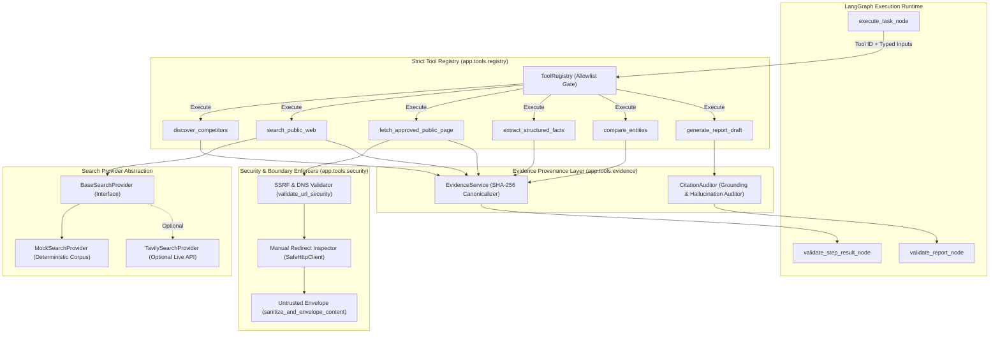

# Phase 13: Strict Tool Registry & Safe Research Tools

## 1. Architectural Overview

AgentOps enforces strict isolation between external untrusted web resources, LLM-generated plan steps, and the underlying host system. The **Safe Tool Sandbox** and **Evidence Provenance Layer** guarantee that:

1. **Zero Arbitrary Code Execution**: No `eval()`, `exec()`, `os.system()`, or `subprocess` calls can ever be executed by the agent runtime. Every available tool is a pre-compiled Python class inheriting from `BaseTool`.
2. **Immutable Tool Allowlist**: The `ToolRegistry` enforces a strict allowlist. Any attempt to invoke an unregistered tool (e.g., `execute_shell`, `run_python`, `curl_download`) immediately halts execution and transitions the run to `FAILED`.
3. **Comprehensive Tool Metadata**: Every registered tool defines:
   - Stable tool ID
   - Typed Pydantic input schema
   - Typed Pydantic output schema
   - Timeout and execution bounds
   - Declarative retry policy (`RetryPolicy`)
   - Risk classification (`RiskLevel`: `LOW`, `MEDIUM`, `HIGH`) and permission scope
   - Resource limits (`ResourceLimits`: max input characters, max output bytes, max seconds)
   - Audit logging requirements (`AuditPolicy`)
4. **Pre-Socket SSRF & IP Validation**: Inbound URL parameters are resolved and screened against RFC 1918 private subnets, loopback addresses (`127.0.0.0/8`, `::1`), link-local/cloud metadata (`169.254.169.254`, `metadata.google.internal`), and multicast before opening any network socket.
5. **Port & Redirect Restrictions**: Only ports 80 and 443 are permitted. HTTP redirects are inspected manually at every intermediate hop (up to 3 hops) to prevent redirect chains into internal networks.
6. **Untrusted Content Envelopes & Prompt Injection Defense**: External page content is stripped of scripts, capped in size, and enclosed inside `<untrusted_source_content>` demarcation tags with cryptographic SHA-256 digests.
7. **Search Provider Interface & Deduplication**: Modular search abstraction supporting a deterministic, offline `MockSearchProvider` and an optional live `TavilySearchProvider`. All search results are normalized and deduplicated by URL and content hash.

---

## 2. Component Architecture



---

## 3. Tool Metadata & Registry Specification

Every tool registered in `ToolRegistry` conforms to the `ToolMetadata` contract:

| Tool ID | Risk Level | Permission Scope | Timeout | Max Output | Primary Responsibilities |
| :--- | :--- | :--- | :--- | :--- | :--- |
| **`discover_competitors`** | `LOW` | `research:read` | 10.0s | 256 KB | Identifies competitor entities in target industry and resolves primary documentation URLs. |
| **`search_public_web`** | `MEDIUM` | `research:read` | 15.0s | 512 KB | Queries external web and competitor intelligence sources with deduplication and SSRF filtering. |
| **`fetch_approved_public_page`** | `MEDIUM` | `research:read` | 20.0s | 1 MB | Fetches approved web pages with pre-socket SSRF, port checks (80/443), manual redirect inspection, and prompt-injection envelope wrapping. |
| **`extract_structured_facts`** | `LOW` | `research:read` | 20.0s | 256 KB | Extracts pricing, SLAs, features, and verbatim excerpts with canonical SHA-256 hashes. |
| **`compare_entities`** | `LOW` | `research:read` | 15.0s | 256 KB | Synthesizes a structured comparative matrix evaluating entities across pricing, SLAs, and capabilities. |
| **`generate_report_draft`** | `HIGH` | `research:synthesize` | 30.0s | 512 KB | Synthesizes structured markdown research deliverables strictly grounded in evidence citations. |

---

## 4. Initial Tool Implementations

### 4.1 `discover_competitors`
- **Input**: `DiscoverCompetitorsInput(domain: str, geography: str | None, max_results: int = 5)`
- **Output**: `DiscoverCompetitorsOutput(domain: str, geography: str, competitors: list[CompetitorEntity], total_found: int, evidence_records: list)`
- **Behavior**: Queries domain knowledge directory to identify candidate competitor products, descriptions, and primary URLs.

### 4.2 `search_public_web`
- **Input**: `SearchPublicWebInput(query: str, domain: str | None, limit: int = 5)`
- **Output**: `SearchPublicWebOutput(query: str, hits: list[SearchHit], total_hits: int, search_provider: str, evidence_records: list)`
- **Behavior**: Uses active `SearchProvider` (`MockSearchProvider` by default, or `TavilySearchProvider` if configured). Normalizes URLs by removing tracking parameters (`utm_*`, `ref`) and deduplicates hits by URL and content hash.

### 4.3 `fetch_approved_public_page`
- **Input**: `FetchApprovedPageInput(url: str, domain: str | None, approved_source_urls: list[str], timeout_seconds: float = 10.0, max_bytes: int = 1_048_576)`
- **Output**: `FetchApprovedPageOutput(url: str, final_url: str, status_code: int, content_type: str, content: str, sanitized_text: str, content_hash: str, byte_count: int, redirect_chain: list, evidence_records: list)`
- **Safety Controls**:
  - Rejects arbitrary unapproved URLs not present in `approved_source_urls` or RFC 2606 documentation domains.
  - Enforces ports `80` and `443` only.
  - Pre-socket DNS check blocks private, loopback, and metadata subnets.
  - Inspects redirect hops manually (`follow_redirects=False`) and re-validates each hop.
  - Strips script and style tags, wrapping output in `<untrusted_source_content>` envelope.

### 4.4 `extract_structured_facts`
- **Input**: `ExtractFactsInput(text: str, domain: str | None, source_url: str | None, categories: list[str])`
- **Output**: `ExtractFactsOutput(domain: str, facts: list[ExtractedFactItem], metrics: dict, total_facts: int, cost_usd: float, evidence_records: list)`
- **Behavior**: Extracts pricing patterns (`$XX/mo`), availability commitments (`99.XX% SLA`), and feature offerings. Anchors every fact to a verbatim source snippet and SHA-256 hash.

### 4.5 `compare_entities`
- **Input**: `CompareEntitiesInput(entities: list[str], dimensions: list[str], domain: str | None, facts_by_entity: dict)`
- **Output**: `CompareEntitiesOutput(entities: list[str], dimensions: list[str], matrix: list[EntityComparisonRow], summary: str, grounded_claims: list, evidence_records: list)`
- **Behavior**: Constructs cross-competitor evaluation matrix comparing entities across pricing, uptime SLAs, and architecture.

### 4.6 `generate_report_draft`
- **Input**: `GenerateReportDraftInput(objective: str, domain: str, evidence_records: list[dict], comparison_summary: str | None, llm_provider: str | None)`
- **Output**: `GenerateReportDraftOutput(title: str, executive_summary: str, grounded_findings: str, strategic_inferences: str, markdown_content: str, citations: list, grounding_coverage_score: float)`
- **Behavior**: Synthesizes formal research report deliverable using the active LLM provider adapter and verifies empirical citation markers (`[E1]`, `[ev-...]`) via `CitationAuditor`.

---

## 5. Security & SSRF Defense Matrix

| Attack Vector | Defense Mechanism | Implementation Location | Test Verification |
| :--- | :--- | :--- | :--- |
| **Loopback probing (`127.0.0.1`, `localhost`)** | Pre-socket IP & hostname blacklist | `app.tools.security.validate_url_security` | Verified across standard, hex (`0x7f000001`), and decimal (`2130706433`) formats. |
| **Cloud metadata theft (`169.254.169.254`)** | Link-local & cloud provider metadata blacklist | `app.tools.security.BLOCKED_IPV4_SUBNETS` | Verified for AWS, GCP (`metadata.google.internal`), and Azure. |
| **Private network probing (RFC 1918)** | Pre-socket subnet blacklist (`10.0.0.0/8`, `172.16.0.0/12`, `192.168.0.0/16`) | `app.tools.security.is_ip_blocked` | Verified across IPv4 and IPv4-mapped IPv6 (`::ffff:10.0.0.1`). |
| **Port scanning via tool URL (`:22`, `:5432`, `:6379`)** | Port restriction to `{80, 443}` only | `app.tools.security.ALLOWED_PORTS` | Verified: non-standard ports immediately rejected. |
| **Redirect to internal network (SSRF via 302)** | Manual redirect hop inspection (max 3 hops) | `app.tools.security.SafeHttpClient.fetch_url` | Verified: redirects to loopback or private IPs aborted at hop 1. |
| **Credential stuffing / userinfo (`user:pass@host`)** | Userinfo `@` syntax rejection | `app.tools.security.validate_url_security` | Verified: URLs with userinfo rejected. |
| **Null byte poisoning (`%00`)** | Null byte detection in URL path and query | `app.tools.security.validate_url_security` | Verified: Null bytes rejected before parsing. |
| **Memory DoS / Oversized payload** | Streaming byte ceiling (default 1 MB) | `app.tools.security.SafeHttpClient.max_bytes` | Verified: responses exceeding limit truncated. |
| **Binary payload ingestion** | MIME Content-Type whitelist (`text/html`, `text/plain`, `application/json`) | `app.tools.security.ALLOWED_CONTENT_TYPES` | Verified: `application/octet-stream` rejected. |
| **Prompt Injection via retrieved page** | `<untrusted_source_content>` envelope tags | `app.tools.security.sanitize_and_envelope_content` | Verified: prompt injections isolated in tagged envelope. |
| **Unregistered tool execution** | Registry allowlist enforcement (`ALLOWED_TOOL_IDS`) | `app.tools.registry.ToolRegistry.execute` | ACCEPTANCE CRITERIA: Unregistered tools hard rejected. |

---

## 6. Verification & Quality Gates

```bash
make validate
```
- **Ruff Linter**: 100% clean check (`ruff check .`).
- **Ruff Formatter**: 144 files verified (`ruff format --check .`).
- **Mypy Type Checker**: Strict static typing passed across 75 source files (`mypy services/backend/app`).
- **Pytest Suite**: 168 tests passing in 2.25s:
  - 57 dedicated security and SSRF tests (`services/backend/tests/security/test_url_safety_and_tools.py`).
  - 19 tool registry and evidence provenance tests (`services/backend/tests/unit/test_tools_and_evidence.py`).
  - 92 baseline, domain model, API, async execution, provider, and LangGraph runtime tests.
