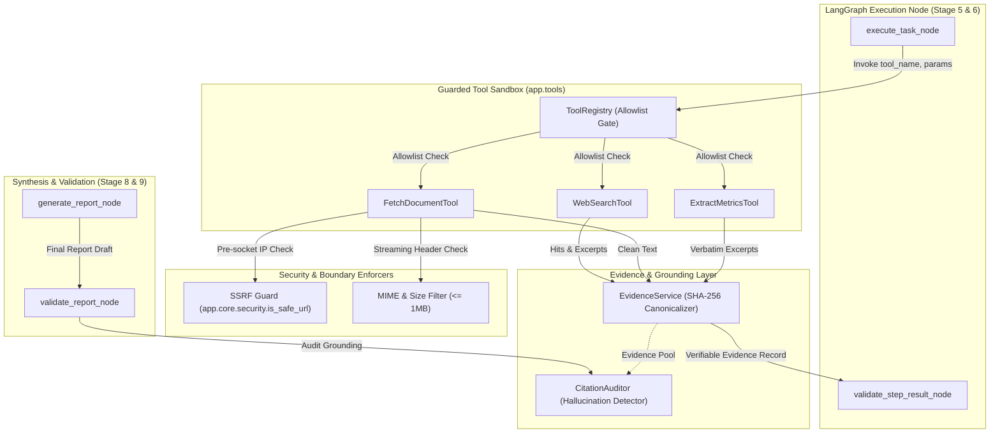

# Phase 13: Safe Tool Sandbox & Evidence Provenance Layer

## 1. Architectural Overview

AgentOps enforces strict isolation between external untrusted resources, LLM-generated plan steps, and the underlying operating system. The **Safe Tool Sandbox** and **Evidence Provenance Layer** guarantee that:
1. **Zero Arbitrary Code Execution**: No `eval()`, `exec()`, `os.system()`, or `subprocess` commands can ever be executed by the agent runtime. Only pre-compiled, registered Python classes inheriting from `BaseTool` are permitted.
2. **Strict Tool Allowlisting**: The `ToolRegistry` enforces an immutable allowlist: `web_search`, `fetch_document`, and `extract_metrics`. Any attempt to request unregistered tools (e.g., `execute_shell`, `run_python`) immediately halts execution and transitions the run to `FAILED`.
3. **Pre-Socket SSRF Protection**: Inbound URL parameters are resolved and screened against RFC 1918 private subnets, loopback addresses (`127.0.0.0/8`, `::1`), link-local/cloud metadata (`169.254.169.254`), and multicast before any network connection is opened.
4. **MIME & Resource Boundaries**: HTTP payloads are limited to 1 MB (`DEFAULT_MAX_BYTES`) and strictly filtered by MIME type (`text/html`, `text/plain`, `application/json`, `application/xml`). Binaries, executables, and media streams are rejected at the header stage.
5. **Cryptographic Evidence Provenance**: Every factual excerpt retrieved from external sources is normalized, assigned a canonical SHA-256 hash, and stored in an immutable evidence record.
6. **Citation Grounding Auditor**: Synthesized final reports are audited against the captured evidence pool to verify that all empirical citations (e.g., `[E1]`, `[ev-...]`) map to untampered evidence records.

---

## 2. Component Architecture



---

## 3. Approved Tools & Execution Contracts

### 3.1 `WebSearchTool` (`web_search`)
- **Purpose**: Queries public competitor intelligence sources or pre-packaged market corpus.
- **Inputs**:
  - `query: str` (1 to 500 characters, required).
  - `domain: str | None` (target market domain).
  - `limit: int` (1 to 20, default 5).
- **Security & Guarantees**:
  - Validates and sanitizes every returned result URL through `is_safe_url`.
  - In mock/offline mode, queries a deterministic corpus (`DEFAULT_COMPETITOR_CORPUS`) covering observability, fintech, and cloud infrastructure without external network access.
  - Generates verifiable evidence records with SHA-256 hashes for each hit snippet.

### 3.2 `FetchDocumentTool` (`fetch_document`)
- **Purpose**: Ingests external web documents, cleans HTML, and prepares text for evidence extraction.
- **Inputs**:
  - `url: str` (valid HTTP/HTTPS URL). If omitted, falls back to `https://example.com/{domain}/pricing`.
  - `timeout_seconds: float` (default: 10.0s).
  - `max_bytes: int` (default: 1 MB).
- **Security & Guarantees**:
  - **Pre-socket SSRF check**: Rejects `localhost`, `127.0.0.1`, RFC 1918 private IPs, and cloud metadata (`169.254.169.254`).
  - **MIME filtering**: Allows only `text/html`, `text/plain`, `application/json`, `application/xml`. Rejects binary/executable formats.
  - **Streaming byte cap**: Reads chunks up to `max_bytes` and terminates stream if exceeded.
  - **Sanitization**: Strips HTML tags, `<script>`, and `<style>` blocks to extract plain text.
  - **Hermetic offline support**: Built-in synthetic documents for RFC 2606 documentation domains (`example.com`, `example.org`, `example.net`) allow 100% offline, zero-DNS testing.

### 3.3 `ExtractMetricsTool` (`extract_metrics`)
- **Purpose**: Extracts structured numerical data, pricing figures, uptime SLAs, and verbatim grounding excerpts.
- **Inputs**:
  - `text: str` (source document text).
  - `domain: str | None` (industry domain).
- **Security & Guarantees**:
  - Deterministic regex extraction for pricing patterns (`$XX/mo`, `$XX/host`) and SLAs (`99.XX% uptime`).
  - Verbatim excerpt matching: captures surrounding context for every extracted metric to ensure 100% grounded citations.
  - Optional LLM structured extraction via `get_llm_provider()` with token cost tracking.

---

## 4. Evidence Provenance & Cryptographic Hashing

The `EvidenceService` (`app.tools.evidence`) guarantees empirical integrity across the research lifecycle:

1. **Text Normalization**: Whitespace, newlines, and control characters are collapsed into a canonical format (`re.sub(r"\s+", " ", text).strip()`) to ensure consistent hashing across platforms.
2. **SHA-256 Content Hashing**: Every evidence item receives a cryptographic digest of its normalized text:
   $$\text{content\_hash} = \text{SHA-256}(\text{normalize\_text}(\text{snippet}))$$
3. **Evidence Record Structure**:
   ```json
   {
     "evidence_id": "ev-87834e3a4bbe",
     "run_id": "test-run-001",
     "step_identifier": "search_market_landscape",
     "tool_name": "web_search",
     "source_url": "https://example.com/datadog/pricing",
     "content_hash": "87834e3a4bbe65cf23cfae...",
     "snippet": "Infrastructure monitoring starts at $15/host/mo...",
     "metadata": {"title": "Datadog Pricing", "query": "cloud observability"},
     "created_at": "2026-10-21T19:16:56Z"
   }
   ```
4. **Tamper Detection**: `EvidenceService.verify_evidence_integrity(record)` recalculates the SHA-256 hash of `snippet` and compares it to `content_hash`. Any post-retrieval manipulation is detected immediately.

---

## 5. Citation Grounding Auditor

The `CitationAuditor` (`app.tools.citation_auditor`) audits report deliverables in Stage 9 (`validate_report_node`):

1. **Citation Marker Parsing**: Detects inline citation markers matching:
   - Numerical aliases: `[E1]`, `[E2]`, etc.
   - Evidence UUID slugs: `[ev-87834e3a4bbe]`.
   - Source identifiers: `[source-1]`.
2. **Grounding Verification**:
   - Maps each cited marker to the corresponding record in `state["evidence_items"]`.
   - Verifies cryptographic hash integrity on each cited record.
   - Detects hallucinated citations (citations that cite non-existent evidence IDs or fabricated references).
3. **Coverage Scoring**:
   $$\text{Coverage Score} = \frac{\text{Verified Citations}}{\max(\text{Total Citations}, 1)}$$
4. **Failure Behavior**: If ungrounded or hallucinated citations are discovered, they are appended to `state["errors"]` as explicit warnings, ensuring transparent operator visibility and transitioning the run to `COMPLETED_WITH_WARNINGS`.

---

## 6. Verification & Quality Gates

The implementation is verified by 111 automated tests spanning unit, contract, and workflow integration:

```bash
make validate
```
- **Ruff linter**: 100% clean check (`ruff check .`).
- **Ruff formatter**: 136 files verified (`ruff format --check .`).
- **Mypy type checker**: Strict static typing passed across 69 source files without error (`mypy services/backend/app`).
- **Pytest suite**: 111 tests passing in under 2 seconds (`pytest services/backend/tests`).
