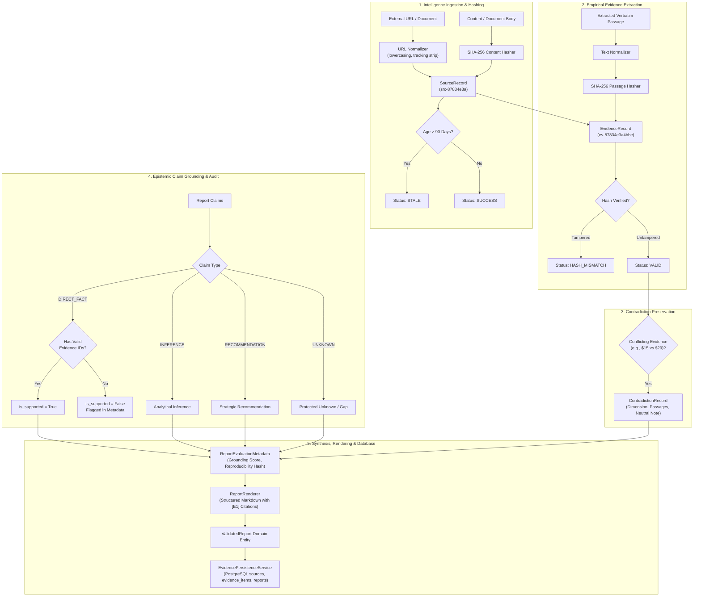

# Phase 14: Evidence Management and Report Generation

## 1. Architectural Overview

AgentOps enforces a traceable, verifiable evidence management pipeline and grounded report synthesis engine for competitive intelligence and market research. The platform's core operational principle is **Empirical Grounding with Cryptographic Traceability**:

1. **Zero Silent Fabrications**: The synthesis engine strictly rejects fabricated quotations, synthetic prices, artificial dates, and hallucinated citations.
2. **Epistemic Claim Classification**: Every claim in the synthesized report is explicitly classified into one of four epistemic categories:
   - **`DIRECT_FACT`**: Empirical assertions anchored directly to one or more verified evidence excerpts with valid content hashes. If a direct fact lacks supporting evidence, it is immediately flagged as unsupported.
   - **`INFERENCE`**: Analytical deductions, trends, or market interpretations derived from evidence or logical reasoning.
   - **`RECOMMENDATION`**: Actionable strategic or operational guidance for operators and decision-makers.
   - **`UNKNOWN`**: Explicitly unobservable, non-disclosed, or missing data points (e.g., custom enterprise pricing, unlisted SLAs).
3. **Unknown Value Protection**: A report must **never** silently convert an unknown or unobservable value into a factual claim. Unknowns are preserved as explicit data gaps and surfaced in the report's limitations section.
4. **Contradiction Preservation**: In competitive market analysis, different sources frequently report conflicting figures (e.g., divergent base pricing or uptime guarantees). Rather than arbitrarily choosing a preferred value or hiding the disagreement, `EvidencePipeline` transparently preserves conflicting evidence in `ContradictionRecord`s with neutral contextual explanations.
5. **Freshness & Staleness Boundaries**: When evaluating market pricing and vendor features, data staleness compromises decision quality. Sources and evidence older than a configurable threshold (default: 90 days) are tracked with `STALE` retrieval and validation statuses.
6. **Uncalibrated Heuristic Confidence**: In accordance with system requirements, model confidence scores are **never** treated as calibrated Bayesian probabilities. Confidence is modeled as a qualitative indicator (`HIGH`, `MEDIUM`, `LOW`, `HEURISTIC`).
7. **Bit-for-Bit Reproducibility**: The evaluation metadata includes a deterministic SHA-256 reproducibility digest computed across all normalized evidence passages, audited claims, contradictions, and narrative summaries.

---

## 2. Pipeline & Dataflow Architecture

---

## 3. Epistemic Model & Schema Contracts

### 3.1 Domain Schemas (`app.evidence.models`)

| Model | Responsibilities & Validation Rules |
| :--- | :--- |
| **`SourceRecord`** | Immutable external intelligence source containing canonical normalized URL, publisher host, UTC retrieval timestamp, SHA-256 content digest, `SourceType` (`web_page`, `documentation`, `pricing_sheet`, `corpus`, `api_response`), and `RetrievalStatus`. |
| **`EvidenceRecord`** | Verifiable empirical excerpt linked to an existing `source_id`. Retains verbatim text, related competitor entity, related claim, UTC extraction timestamp, `ExtractionStatus`, `ValidationStatus` (`VALID`, `HASH_MISMATCH`, `CONTRADICTORY`, `STALE`, `UNVERIFIED`), and SHA-256 snippet digest. |
| **`ReportClaim`** | Distinct claim containing `claim_id`, `claim_type` (`DIRECT_FACT`, `INFERENCE`, `RECOMMENDATION`, `UNKNOWN`), entity, statement text, referenced `evidence_ids`, uncalibrated `confidence` level, `is_supported` boolean, and optional `contradiction_notes`. |
| **`ContradictionRecord`** | Preserved empirical discrepancy capturing commercial dimension (e.g., pricing, uptime), competitor entity, conflicting passages with evidence citations, and transparent resolution note. |
| **`CompetitorComparisonItem`** | Standardized entity profile comparing competitor name, pricing summary, SLA/availability, key features list, deployment models, and limitations. |
| **`ReportEvaluationMetadata`** | Comprehensive audit trail: total claims, direct facts count, inferences count, recommendations count, unknowns count, supported claims count, unsupported claims list, contradictions count, grounding coverage score ($0.0$ to $1.0$), `is_valid` flag, and reproducibility digest. |
| **`ValidatedReport`** | Top-level deliverable enforcing minimum lengths on title, executive summary, positioning analysis, bibliography, evaluation metadata, and fully rendered markdown. |

---

## 4. Deterministic Markdown Report Structure

The `ReportRenderer` formats the deliverable into eight structured sections with explicit citation badges and provenance tables:

1. **Title & Evaluation Banner**: Headline, domain sector, grounding coverage ratio, and validation outcome.
2. **`1. Executive Summary`**: High-level strategic briefing.
3. **`2. Competitor Comparison Matrix`**: Structured Markdown table comparing competitors across pricing, SLAs, features, deployment, and limitations.
4. **`3. Evidence-Linked Findings`**: Bulleted statements annotated with epistemic badges (`[DIRECT FACT]`, `[INFERENCE]`, `[RECOMMENDATION]`, `[UNKNOWN]`), citation markers (`[E1]`, `[E2]`), confidence rating, and warnings if unsupported or contradictory.
5. **`4. Preserved Contradictions & Discrepancies`**: Detailed table preserving conflicting market evidence and neutral analysis.
6. **`5. Strategic Positioning Analysis`**: Deep-dive qualitative analysis.
7. **`6. Limitations, Unknowns & Freshness Boundaries`**: Documented data gaps, unobservable features, and staleness boundaries.
8. **`7. Sources & Provenance Bibliography`**: Complete citation table mapping `[E1]` markers to source URLs, publishers, content hashes, and validation statuses.
9. **`8. Provenance & Reproducibility Audit`**: Epistemic breakdown, grounding coverage score, and the 64-character SHA-256 reproducibility digest.

---

## 5. Persistence Integration (`EvidencePersistenceService`)

The pipeline bridges in-memory research structures with relational PostgreSQL tables:

- **`sources` table**: Maps `SourceRecord` with unique constraint `(run_id, url)` and indexes on `(run_id, domain)` and `content_hash`.
- **`evidence_items` table**: Maps `EvidenceRecord` with foreign key to `sources.id` and unique constraint `(run_id, content_hash)`.
- **`reports` table**: Stores finalized `ValidatedReport` deliverable with unique constraint `(run_id)`, JSONB structured `citations`, and JSONB `metadata_payload` containing `evaluation_metadata`, competitor matrices, and contradictions.

---

## 6. Verification and Acceptance Matrix

| Requirement / Acceptance Test | Test Case (`test_evidence_and_reports.py`) | Status |
| :--- | :--- | :--- |
| **URL Canonicalization & Deduplication** | `test_source_registration_and_url_normalization` | Passed |
| **90-Day Freshness & Staleness Cascading** | `test_source_staleness_tracking` | Passed |
| **Invalid Source ID Rejection** | `test_invalid_source_id_rejected` | Passed |
| **SHA-256 Evidence Integrity Verification** | `test_evidence_registration_and_integrity_verification` | Passed |
| **Direct Fact Requires Valid Evidence** | `test_direct_fact_requires_valid_evidence` | Passed |
| **Unknown Value Protection (Never Converted)** | `test_unknown_value_protection` | Passed |
| **Epistemic Metric Scoring & Unsupported Detection** | `test_report_epistemic_audit_metrics` | Passed |
| **Preservation of Conflicting Prices** | `test_preserve_conflicting_prices` | Passed |
| **Bit-for-Bit Reproducibility Hash Determinism** | `test_reproducibility_hash_determinism` | Passed |
| **Markdown Rendering & Inline Citations** | `test_report_renderer_formatting` | Passed |
| **Explicit Flagging of Unsupported Claims** | `test_unsupported_claim_flagged_in_markdown` | Passed |
| **Schema Bounds & Minimum Length Validation** | `test_short_title_or_summary_rejected` | Passed |
| **PostgreSQL Persistence Integration** | `test_persist_pipeline_bundle_with_mock_session` | Passed |
