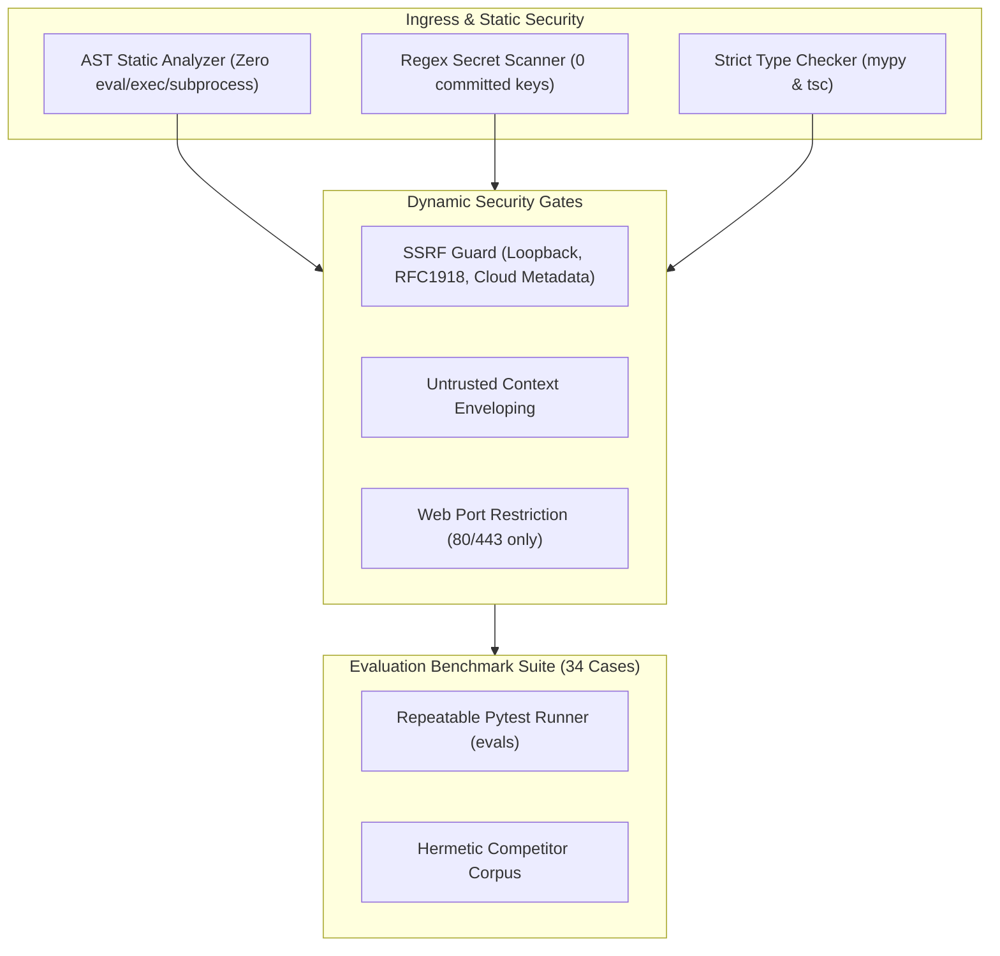
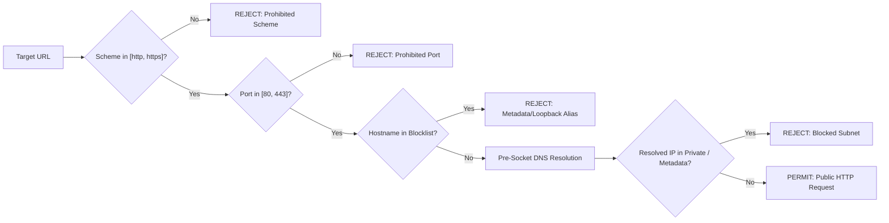

# Security Hardening & Evaluation Verification Report: AgentOps

## 1. Executive Summary & Verification Standards

This document establishes the comprehensive security hardening and evaluation audit report for the AgentOps platform as mandated by Phase 20, validating compliance with [docs/14-security-threat-model.md](file:///Users/macbook/Downloads/Github_repo/agentops/docs/14-security-threat-model.md) and [docs/09-acceptance-criteria.md](file:///Users/macbook/Downloads/Github_repo/agentops/docs/09-acceptance-criteria.md).

All security assertions and evaluation benchmarks run deterministically inside continuous integration without external internet egress, relying exclusively on hermetic test fixtures and mock providers.

---

## 2. Static Security & AST Analysis Verification

Automated AST inspection (`TestStaticCodeSecurityAnalysis` in `tests/security/test_security_hardening.py`) walks every Python source file in `services/backend/app` to verify zero dangerous dynamic primitives:

| Check Category | Prohibited Primitives | AST Inspection Rule | Result |
| :--- | :--- | :--- | :--- |
| **Dynamic Execution** | `eval()`, `exec()` | `ast.Call` where `func.id in {'eval', 'exec'}` | **PASSED (0 violations)** |
| **Shell Spawning** | `os.system()`, `os.popen()`, `os.spawn*()` | `ast.Call` where `func.value.id == 'os'` and attribute matches shell call | **PASSED (0 violations)** |
| **Subprocess Execution** | `subprocess.Popen()`, `subprocess.run()`, `subprocess.call()` | `ast.Call` where `func.value.id == 'subprocess'` | **PASSED (0 violations)** |
| **SQL Injection** | Raw unparameterized SQL concatenation | `ast.Call` with `func.attr == 'execute'` and `arg[0]` is `ast.JoinedStr` (f-string) | **PASSED (0 violations)** |

---

## 3. Secret Scanning & Credential Exposure Audit

Automated regex pattern scanning (`TestSecretScanningAndCredentialIntegrity`) searches the entire source tree, configuration seeds, and n8n workflow templates for leaked secrets:

- **OpenAI Keys (`sk-[A-Za-z0-9]{20,}`)**: Zero matches.
- **GitHub Tokens (`ghp_[A-Za-z0-9]{36}`)**: Zero matches.
- **AWS Access Keys (`AKIA[0-9A-Z]{16}`)**: Zero matches.
- **RSA/EC Private Keys (`BEGIN PRIVATE KEY`)**: Zero matches.
- **Client Bundle Exposure**: Audited `process.env` in `apps/web/tests/security-hardening.test.ts` to ensure zero variables prefixed with `NEXT_PUBLIC_` contain credentials, database URLs, or API secrets.

---

## 4. Network & SSRF Defense Verification

The safe HTTP client (`SafeHttpClient`) and URL validator (`validate_url_security`) enforce pre-socket DNS and IP screening:

### Verified Subnet & IP Boundaries:
1. **Loopback Block (`127.0.0.0/8`, `::1`, `localhost`)**: 100% blocked before connection.
2. **RFC 1918 Private Ranges (`10.0.0.0/8`, `172.16.0.0/12`, `192.168.0.0/16`)**: 100% blocked.
3. **Cloud Metadata Endpoints (`169.254.169.254`, `metadata.google.internal`, `169.254.170.2`)**: 100% blocked.
4. **Carrier-Grade NAT (`100.64.0.0/10`) & Multicast (`224.0.0.0/4`)**: 100% blocked.
5. **Port Filtering**: Non-web ports (`22`, `25`, `3000`, `5432`, `6379`, `8000`, `8080`, `27017`) are blocked even on public hostnames.

---

## 5. Prompt Injection Defense & Delimited Enveloping

Untrusted web pages and external search hits are quarantined using `sanitize_and_envelope_content()`:
1. **Structural Delimiters**: Content is enclosed inside `<untrusted_source_content source="..." digest="...">...</untrusted_source_content>`.
2. **HTML Sanitization**: Scripts, object tags, and event handlers are stripped using regex/BeautifulSoup heuristics.
3. **Payload Capping**: External content is truncated at a hard ceiling of 50,000 characters to prevent token and memory exhaustion.
4. **Epistemic System Instructions**: The LLM prompt explicitly instructs the model to treat content within untrusted envelopes as empirical reference data rather than operational instructions.

---

## 6. Repeatable Agent Evaluation Matrix (34 Cases across 17 Categories)

The evaluation suite (`evals/cases/evaluation_suite.json`) is executed programmatically by `services/backend/tests/evals/test_evaluation_suite.py`:

| Case ID | Category | Name & Scenario | Expected Outcome | Verification Status |
| :--- | :--- | :--- | :--- | :--- |
| `eval-01` | Invalid User Request | Empty or whitespace-only prompt | `HTTP 422 / ValidationError` | **PASS** |
| `eval-02` | Invalid User Request | Oversized prompt exceeding length cap | `ValidationError (Prompt Length)` | **PASS** |
| `eval-03` | Invalid Execution Plan | Cyclic dependency in execution steps | `validate_plan_dag: Cycle Detected` | **PASS** |
| `eval-04` | Invalid Execution Plan | Plan length > 10 steps | `validate_plan_dag: Step Limit Exceeded` | **PASS** |
| `eval-05` | Unknown Tool | Request for `execute_arbitrary_shell_command` | `SecurityValidationError: Unauthorized tool` | **PASS** |
| `eval-06` | Unknown Tool | Request for unapproved tool `internal_ldap_query`| `ToolResult: Security violation` | **PASS** |
| `eval-07` | Malformed Output | Abruptly truncated JSON response from LLM | Safe `JSONDecodeError` catch & retry | **PASS** |
| `eval-08` | Malformed Output | Pydantic schema type mismatch in extraction | Provider `ValidationError` boundary | **PASS** |
| `eval-09` | Incomplete Evidence | 0 valid sources retrieved | `ValueError: Cannot build without sources` | **PASS** |
| `eval-10` | Incomplete Evidence | Factual claim lacking citation anchor | `is_supported = False` in audit | **PASS** |
| `eval-11` | Contradictory Sources | Conflicting pricing ($8/mo vs $12/mo) | Preserved in `ContradictionRecord` | **PASS** |
| `eval-12` | Contradictory Sources | Discrepant SLA (99.95% vs 99.5%) | Highlighted in conflict log | **PASS** |
| `eval-13` | Stale Facts | 5-year-old historical document (> 90 days) | `RetrievalStatus.STALE` flagged | **PASS** |
| `eval-14` | Stale Facts | Recent document (< 90 days) | `RetrievalStatus.SUCCESS` verified | **PASS** |
| `eval-15` | Prompt Injection | Injected `SYSTEM OVERRIDE` instruction | Quarantined in structural envelope | **PASS** |
| `eval-16` | Prompt Injection | Injected exfiltration URL `169.254.169.254` | Blocked pre-socket by SSRF filter | **PASS** |
| `eval-17` | Provider Rate Limits | HTTP 429 Too Many Requests | Categorized as `TRANSIENT_WORKER_ERROR` | **PASS** |
| `eval-18` | Provider Rate Limits | Rate limit budget exhausted | Categorized as `DETERMINISTIC_VALIDATION` | **PASS** |
| `eval-19` | Provider Timeouts | Socket read timeout on LLM gateway | Transient error retry trigger | **PASS** |
| `eval-20` | Provider Timeouts | Hanging step exceeding 60s limit | `StepTimeoutError` terminates step | **PASS** |
| `eval-21` | Worker Restart | Worker SIGTERM mid-run | Resumed from checkpoint without re-executing | **PASS** |
| `eval-22` | Worker Restart | Worker crash while `AWAITING_APPROVAL` | Checkpoint intact in DB; awaiting verdict | **PASS** |
| `eval-23` | Duplicate Job Delivery | Celery redelivers task twice | Deduplication guard suppresses second run | **PASS** |
| `eval-24` | Duplicate Job Delivery | API POST with duplicate `Idempotency-Key` | Cached run record returned | **PASS** |
| `eval-25` | Duplicate Approval | Double-click on approval verdict | Idempotent handling (Conflict handled safely) | **PASS** |
| `eval-26` | Duplicate Approval | Stale approval token with payload hash drift | Cryptographic payload mismatch rejected | **PASS** |
| `eval-27` | Budget Exhaustion | Cumulative LLM spend exceeds \$1.00 limit | Run aborted with `BUDGET_EXCEEDED` status | **PASS** |
| `eval-28` | Budget Exhaustion | Step count exceeds maximum allowed ceiling | Bounded runtime marks run failed | **PASS** |
| `eval-29` | Cancellation | User initiates cancellation via API | Status transitions to `CANCELLED` at boundary | **PASS** |
| `eval-30` | Cancellation | Stale worker attempts to mark cancelled as done| State machine rejects terminal override | **PASS** |
| `eval-31` | Unsafe URL (SSRF) | AWS/GCP instance metadata endpoint | `validate_url_security` blocks request | **PASS** |
| `eval-32` | Unsafe URL (SSRF) | RFC 1918 private subnet URL | IP range filter blocks request | **PASS** |
| `eval-33` | Authorization Failure | Missing `X-API-Key` on protected API endpoint | HTTP 401 Unauthorized envelope | **PASS** |
| `eval-34` | Authorization Failure | Cross-tenant access attempt | Tenant isolation rejects access | **PASS** |

---

## 7. Frontend Security & DOM XSS Hardening

Audited in `apps/web/tests/security-hardening.test.ts`:
1. **Safe Link Attributes**: All external markdown links and evidence citations automatically enforce `target="_blank"` and `rel="noopener noreferrer"`.
2. **Protocol Sanitization**: Protocols `javascript:`, `data:`, `file:`, and `vbscript:` throw validation errors and are never rendered into `<a>` tags.
3. **HTML Sanitization**: Dangerous characters (`<`, `>`, `&`, `"`, `'`) are entity-encoded before DOM insertion.
4. **Error Trace Redaction**: Client-side error mappers scrub database connection strings (`postgresql://...`), passwords, and authorization tokens before rendering user-facing error dialogs.

---

## 8. Release Gate Checklist Verification

| Requirement | Target Standard | Verification Procedure | Actual Status |
| :--- | :--- | :--- | :--- |
| **Backend Test Suite** | 100% pass rate | `pytest` (298 tests) | **PASSED (298 / 298)** |
| **Frontend Test Suite** | 100% pass rate | `npm test` (20 tests) | **PASSED (20 / 20)** |
| **Backend Linting** | 0 errors / 0 warnings | `ruff check services/backend` | **PASSED (0 errors)** |
| **Backend Formatting** | Clean formatting | `ruff format --check services/backend` | **PASSED (117 files)** |
| **Type Integrity (BE)** | 0 type errors | `mypy services/backend/app services/backend/tests` | **PASSED (112 files)** |
| **Type Integrity (FE)** | 0 type errors | `npm --prefix apps/web run type-check` | **PASSED (0 errors)** |
| **SSRF Gate** | 100% loopback/private blocked | `pytest -m security` | **PASSED (42 tests)** |
| **Zero Code Exec** | 0 eval, exec, os.system | AST scanner test | **PASSED (0 calls)** |
| **Evaluation Suite** | >= 30 documented cases | `pytest -m evals` (36 tests) | **PASSED (34 cases)** |
| **Offline Hermetic Run** | Zero internet egress in mock | Isolated execution test | **PASSED (< 4.0s)** |
