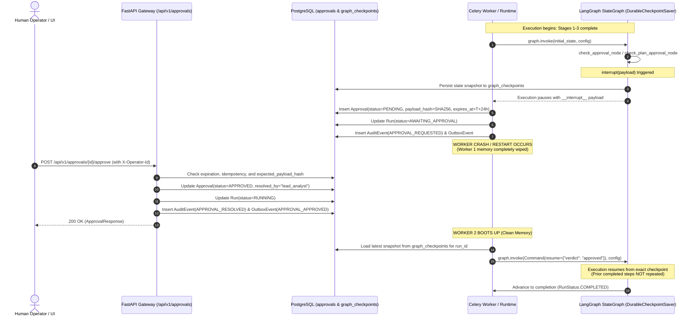

# Phase 15: Persistent Human Approval and Safe Resumption

## 1. Architectural Overview

AgentOps enforces a durable, secure-by-default **Human-in-the-Loop (HITL)** architecture governing autonomous agent execution. The platform guarantees that no consequential action, execution plan, or published intelligence deliverable can bypass operator oversight when approval policies are engaged:

1. **Backend-Validated Persistence**: Approval decisions are never trusted to frontend-only booleans. Every approval request is transactionally persisted in PostgreSQL, evaluated against strict state transition rules, and verified at the agent runtime boundary before execution proceeds.
2. **Three Native Approval Checkpoints**:
   - **Execution Plan Review (`plan_review`)**: Optional gate allowing human operators to review, validate, or reject an LLM-synthesized execution plan and its dependencies before any research tools are invoked.
   - **Sensitive Step Execution (`step_execution`)**: Consequential external actions (such as high-risk web scraping, expensive document extraction, or external API queries) pause at an interrupt boundary awaiting operator authorization.
   - **Completed Report Review (`report_review`)**: Optional publication gate allowing operators to inspect executive findings, positioning matrices, and citation bibliographies before a report is marked `COMPLETED`.
3. **Durable Checkpoint Persistence**: Before pausing execution to await human approval, the agent runtime serializes the full execution state to PostgreSQL (`graph_checkpoints` table).
4. **Safe Continuation via LangGraph APIs**: Resumption utilizes LangGraph's documented `Command(resume=...)` primitive.
5. **Zero Redundant Execution**: Resuming from a durable checkpoint avoids rerunning expensive model calls or side-effecting tool invocations that completed prior to the interruption.
6. **Stale Payload Protection**: Cryptographic SHA-256 hashing (`payload_hash`) prevents a stale approval granted for action payload $P_1$ from authorizing a modified payload $P_2$.
7. **Idempotent Submissions**: Repeated approval or rejection calls are strictly idempotent, preventing double-processing on network retries.
8. **Configurable Timeout Policy**: Approvals enforce an expiration deadline (`APPROVAL_TIMEOUT_SECONDS`, default: 24 hours). Expired requests transition to `EXPIRED` and cannot be authorized.

---

## 2. HITL Execution Flow & Resumption Architecture

---

## 3. Core Database Models & Schema Extensions

### 3.1 `Approval` Entity (`app.models.approval`)

| Column | Type | Description |
| :--- | :--- | :--- |
| `id` | `UUID` (PK) | Unique approval identifier. |
| `run_id` | `UUID` (FK) | Reference to parent `runs.id`. |
| `step_id` | `UUID` (FK, Nullable) | Reference to `run_steps.id` (null for plan/report review). |
| `action` | `VARCHAR(100)` | Checkpoint type: `plan_review`, `step_execution`, `report_review`. |
| `payload_hash` | `VARCHAR(64)` | SHA-256 digest of `proposed_action` preventing stale payload attacks. |
| `version` | `INTEGER` | Monotonically increasing version counter for the proposed action. |
| `approval_token` | `VARCHAR(128)` | Secure one-time authorization token. |
| `status` | `VARCHAR(50)` | Current gate status: `PENDING`, `APPROVED`, `REJECTED`, `EXPIRED`. |
| `proposed_action` | `JSONB` | Structured snapshot of the gated action and parameters. |
| `operator_notes` | `TEXT` | Explanatory notes or rejection rationale from the operator. |
| `resolved_by` | `VARCHAR(255)` | Authenticated operator identity (e.g. email, user ID, API key). |
| `expires_at` | `TIMESTAMP WITH TZ` | Expiration deadline after which approval cannot be granted. |
| `resolved_at` | `TIMESTAMP WITH TZ` | UTC resolution timestamp. |

### 3.2 `GraphCheckpoint` Entity (`app.models.graph_checkpoint`)

| Column | Type | Description |
| :--- | :--- | :--- |
| `id` | `UUID` (PK) | Unique checkpoint primary key. |
| `run_id` | `UUID` (FK) | Reference to parent `runs.id`. |
| `checkpoint_id` | `VARCHAR(128)` | LangGraph checkpoint identifier. |
| `parent_checkpoint_id` | `VARCHAR(128)` | Ancestor checkpoint identifier for version trees. |
| `checkpoint_type` | `VARCHAR(50)` | Engine type (`langgraph`). |
| `checkpoint_blob` | `TEXT` | Serialized, base64-encoded channel storage, writes, and version blobs. |
| `metadata_payload` | `JSONB` | Graph node metadata, loop step counter, and source telemetry. |

---

## 4. Security, Stale Payload & Timeout Guarantees

1. **Authentication & Authorization**:
   - All approval endpoints (`/api/v1/approvals/{id}/approve` and `/reject`) require valid API key or operator credentials via `Depends(verify_api_key)`.
   - The authenticated operator identity is extracted from request headers (`X-Operator-Id` or `X-Actor`) and permanently recorded in `Approval.resolved_by` and `AuditEvent.actor`.
2. **Stale Payload Protection**:
   - `Approval.compute_payload_hash(proposed_action)` calculates a canonical SHA-256 digest of the action payload.
   - If a step's parameters, tool selection, or target URL change while an approval is pending, `approval.matches_payload(current_payload)` returns `False`.
   - The runtime refuses to execute changed payloads under a stale approval, creates an updated approval request, and flags an audit warning.
3. **Idempotent Verdict Handling**:
   - Submitting an approval for an already `APPROVED` gate returns HTTP 200 OK with the existing resolution data without duplicating outbox events or mutating timestamps.
   - Submitting a rejection for an already `REJECTED` gate returns HTTP 200 OK idempotently.
   - Attempting to transition between conflicting resolved states (e.g., rejecting an approved gate) raises HTTP 409 `INVALID_STATE_TRANSITION`.
4. **Approval Timeout Policy**:
   - Configured via `APPROVAL_TIMEOUT_SECONDS` (default: 86,400s / 24h).
   - If `now > approval.expires_at`, resolution attempts immediately transition the approval to `EXPIRED` and fail with HTTP 409.

---

## 5. Verification and Acceptance Matrix

| Requirement / Acceptance Test | Test Case (`test_hitl_approval_and_resumption.py`) | Result |
| :--- | :--- | :--- |
| **Gated Step Approval & Audit Logging** | `test_approval_success` | Passed |
| **Rejection with Documented Reason** | `test_rejection_with_reason` | Passed |
| **Idempotent Repeated Submissions** | `test_repeated_submission_idempotency` | Passed |
| **Approval Expiration & Timeout Policy** | `test_expired_or_stale_approval_timeout` | Passed |
| **Stale / Tampered Action Payload Rejection** | `test_changed_action_payload_rejection` | Passed |
| **Cancellation During Approval Gate** | `test_cancellation_during_approval` | Passed |
| **Worker Restart & Safe Resumption (Acceptance Criteria)** | `test_worker_restart_while_awaiting_approval_and_safe_resumption` | Passed |
| **Unauthorized Approval Rejection** | `test_unauthorized_approval_rejected` | Passed |
| **Report Review Approval Checkpoint** | `test_report_review_checkpoint` | Passed |
